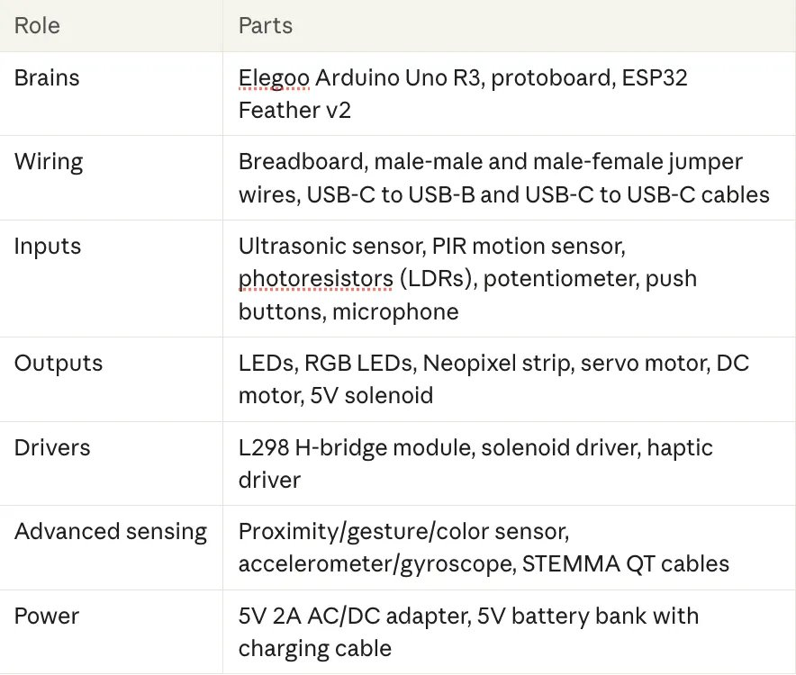
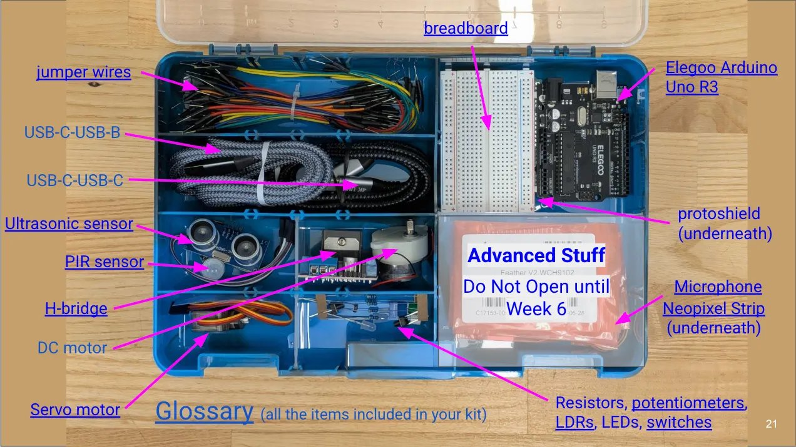
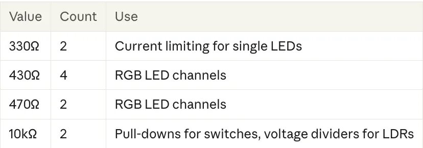
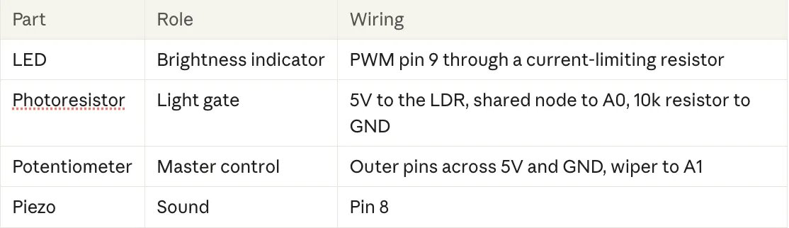
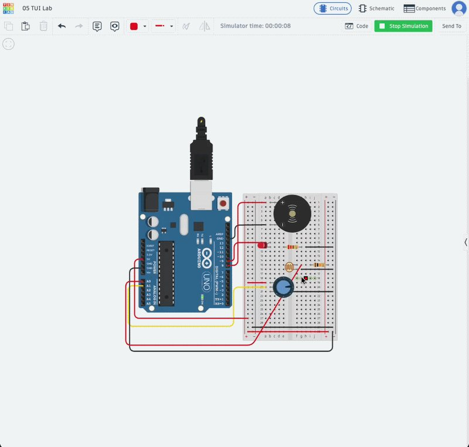
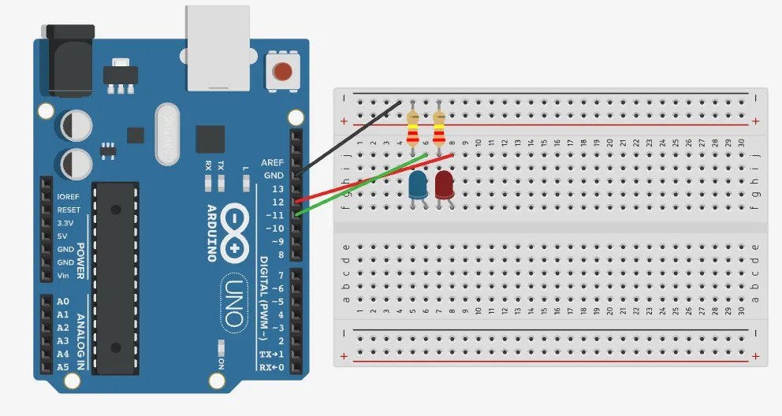
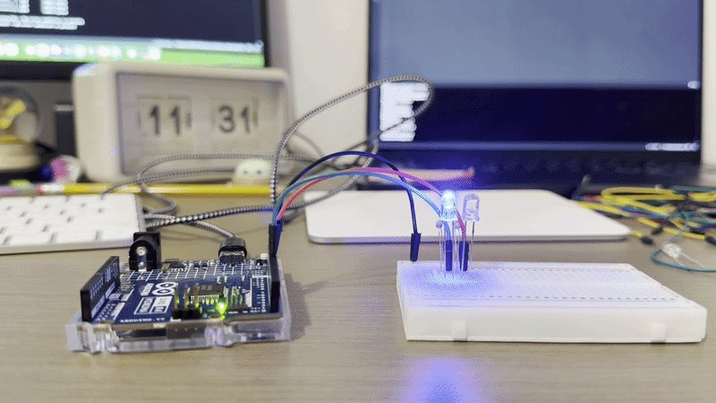

# W1 E1: Kickoff, the kit and first circuits

**Week 1 · Electronics · Tue Oct 20, 2026**
Lecture: [C15](../../sources/lecture-slides.md) · Published on Medium: [W1 E1](https://medium.com/@cassiusp/w1-e1-tdf-physcomp-23bf40edd487) · Original: [PDF](../../sources/medium-pdfs/W1-E1-tdf-physcomp.pdf)

## Assignment

From the homework slides [C15, slides 14 and 27]:

- Install the Arduino software, review Dr. Sudhu's Arduino Tutorial [T-ARD], and take Lady Ada's Arduino tour [T-ADA].
- Write a program that flashes the onboard LED while printing "Hello World" to serial.
- Make "something interesting" happen with 1 LED + 1 LDR, and with 2 or more LEDs. Document with 1 video + images, code files + circuit diagrams, and a short write-up.

## Journal entry

Half a semester of Computational Design taught me to build with models, APIs and prompts. This week the screen went down and a plastic box of parts came up. I have moved to the Physical Computing track of Technology Design Foundations (TDF) at Berkeley MDes, and this first entry covers the kickoff: what the section is for, what is in the kit, and the first circuits on my bench.

### Serious play, doing over thinking

TDF exists to build fluency with emerging technology as a design material. The course frames it as a place to build competency in technology that matters to contemporary practice, then use that judgment to fold technology into real design work.

The teaching team (Sudhu Tewari on electronics and programming, Chris Myers on fabrication and prototyping, Alistair Vizuet as GSI on mechanical engineering) named three values up front:

- Serious play. Experiment on purpose.

- Doing over thinking. Build first, theorize after.

- Making m1stak3s. Errors are data, not failures.

Underneath all three sits one word repeated: iteration, iteration, iteration.

### The road ahead: eight weeks, three stages

The Physical Computing half moves fast. Everything below lands in roughly eight weeks:

1. The basics (2 weeks). A charrette of skill builders: laser cut rings, 3D printed rings and microcontroller exercises. Tuesdays are electronics, Thursdays are fabrication and prototyping.

2. Expressive Mechanics (2 weeks). The first foundational project, about motion that communicates.

3. Ambient Display (2.5 weeks). The second, about information that lives quietly in a space.

### Opening the box

Every student gets the same compartmented kit. Laid out, it reads like a vocabulary list for the next eight weeks:





### Learning to read stripes

Before any code, we learned to read resistors. Each colored band stands for a digit (black 0, brown 1, red 2, orange 3, yellow 4, green 5, blue 6, violet 7, grey 8, white 9). The digit bands come first, then a multiplier, then tolerance. On a 5-band resistor, yellow violet black black brown decodes to 4, 7, 0, times 1, plus or minus 1%: 470Ω.

The kit holds four values, each with a job:



When in doubt, the [DigiKey resistor color code calculator](https://www.digikey.com/en/resources/conversion-calculators/conversion-calculator-resistor-color-code) settles it. As an architect, I appreciated that this is a drawing convention like any other: a compressed notation you learn once and then read at a glance.

### First circuits

In class we started [Dr. Sudhu’s Arduino Tutorial,](https://github.com/loopstick/ArduinoTutorial) aiming to reach the RGB LED section. Prep work included installing the [Arduino IDE](https://www.arduino.cc/en/software/) and taking [Lady Ada’s Arduino tour.](https://learn.adafruit.com/ladyadas-learn-arduino-lesson-number-0)

### Exercise 1: Blink while saying hello

The first task: flash the onboard LED while printing “Hello World” to the serial monitor.

```
void setup() {
  pinMode(LED_BUILTIN, OUTPUT);
  Serial.begin(9600);
}
void loop() {
  digitalWrite(LED_BUILTIN, HIGH);
  Serial.println("Hello World");
  delay(500);
  digitalWrite(LED_BUILTIN, LOW);
  delay(500);
}
```

### Exercise 2: One LED, one LDR

The brief: make “something interesting” happen with one LED and one photoresistor. I had already built this one. For my Tangible User Interfaces Lab 05, I made a light-gated Theremin on an Arduino Uno: a potentiometer controls both an LED’s brightness and a piezo’s pitch, and a photoresistor decides whether you get to hear it. Dark room, continuous tone. Bright room, silence. (Adapted from my TUI Lab 05 write-up.)

The idea came from sleep playlists that put frequencies like 432 Hz or 528 Hz front and center. I liked how they make an invisible number feel visible, so I wanted my instrument to show the Hz you’re making.



The photoresistor needs that 10k partner because it only changes resistance. Paired with a fixed resistor, it forms a voltage divider the Arduino can read as a voltage. That is exactly what the kit’s 10kΩ resistors are for.

The bug that taught me the most. My first build didn’t work, and the Serial Monitor showed why. The pot and the LDR were both bouncing between the same two values, 428 and 692. Two different sensors with identical readings means neither is wired where the code thinks. GND and A0 were swapped at the header, and one power rail had no 5V. After fixing both, the LDR read 969 in the dark and 49 in bright light.

That also exposed a logic error: in my divider, bright light gives a low reading, so my comparison was backwards. The final cutoff:

```
if (potValue <= 5 || ldrValue < 210) {
  noTone(PIEZO_PIN);
}
```

I then smoothed the knob with a moving average and mapped pitch logarithmically (100 to 2000 Hz) so the sweep sounds even. A companion web page turns the pitch into a gradient that rises and warms as the Hz climbs.



[Video: 05 LAB](https://www.youtube.com/watch?v=LsINTwnH_KI)

### Exercise 3: Two or more LEDs

For two or more LEDs, I went back to my very first TUI lab. After watching a police car chase someone down near Berkeley Street, I wanted to recreate that flash pattern. The result is a two-light alternating flasher: LEDs on pins 12 and 11, each with its own 220Ω resistor, both returning to a shared ground rail, flashing in alternating bursts of three. (Adapted from my TUI Lab 1 write-up.)

I prototyped it in Tinkercad first. Partly for confidence, partly because I have large hands and didn’t want to bend the breadboard’s prongs while still learning where things go. Simulating first let me make mistakes for free, then move a layout I trusted onto the real board.

Most of my problems were wiring, not code. My first external LED stayed dark because it was in backwards: an LED only conducts one way and gives no warning. I also learned that breadboard strips connect in short groups of five holes, so laying parts in a neat line connected nothing. And with two LEDs, both had to route back to one shared ground rail.

This is where the I/O pins clicked for me. Each pin is individually addressable: pinMode() declares it an output and digitalWrite() signals that one pin. The two LEDs don't share a signal. Each gets its own, timed against the other in the loop. The physical build behaved exactly like the simulation, with one surprise: my knuckle brushed a resistor and I could feel it warming.





What worked: Simulating in Tinkercad before touching hardware, and printing sensor values to the Serial Monitor before changing any code.

What broke: A backwards LED, a swapped GND and A0 wire, and an unpowered rail. Every one was wiring. Identical or frozen readings almost always mean a connection problem, not a logic problem.

### Reflection

Coming from Computational Design, the contrast is the lesson. In software, a mistake costs a refresh. On a breadboard, a mistake costs a burned LED or a wire in the wrong row, and you feel it. That friction slows me down in a useful way: I have to understand the circuit before the code means anything.

It also connects to my other work this fall. In Tangible User Interfaces we are designing physical interactions, and this kit is the toolset that turns those sketches into working objects.

## Sources

- [C15] 2026 TDF - PhysComp class 15 - Overview/Arduino
- [T-ARD] Tewari, Arduino Tutorial
- [T-ADA] Adafruit, Lady Ada's Learn Arduino, Lesson 0
- Original Medium story: https://medium.com/@cassiusp/w1-e1-tdf-physcomp-23bf40edd487
