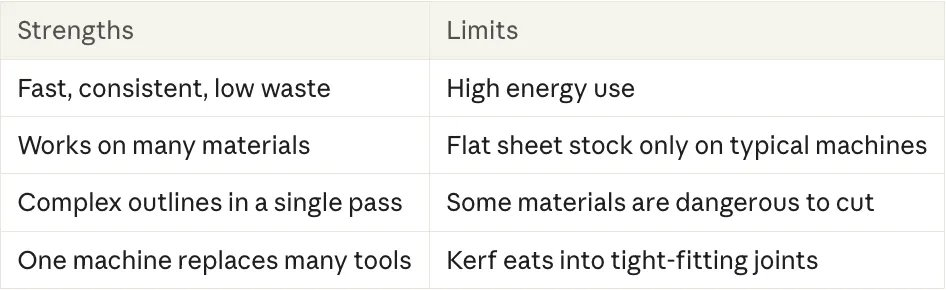
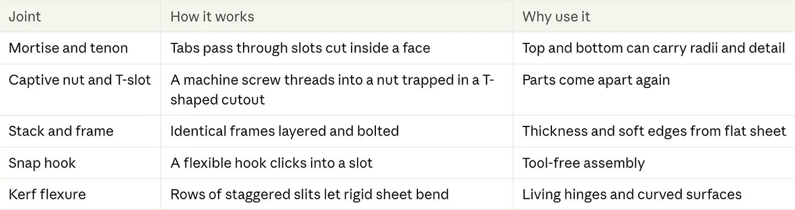

# W1 E2: Laser cutting, joinery and the 737 ring

**Week 1 · Fabrication · Thu Oct 22, 2026**
Lecture: [C16](../../sources/lecture-slides.md) · Published on Medium: [W1 E2](https://medium.com/@cassiusp/w1-e2-tdf-physcomp-ea0f7cbf61ea) · Original: [PDF](../../sources/medium-pdfs/W1-E2-tdf-physcomp.pdf)

## Assignment

- Complete the online laser cutter training [T-LASER] and install Adobe Illustrator and Fusion 360 [C15, slide 28].
- Laser-cut ring: "Create a ring that describes a part of your personality or a cause you believe in. Make it bold. Make it big." Constraints: simplicity, fit, finish [C16; C17, slide 25].

## Journal entry

Tuesdays are electronics. Thursdays are fabrication. After a first session spent with LEDs and resistors, the second class traded the breadboard for the laser cutter. So I designed a ring that says something about who I am; I answered with an airplane.

### Laser cutting, briefly

Digital fabrication splits into two families. Laser cutting is subtractive: it takes material away. 3D printing is additive: it builds material up. Both start from a CAD file, which is what makes them fast to iterate.

A laser cutter cuts, etches and rasters sheet material from a 2D drawing. Mirrors steer the beam to a nozzle, a lens focuses it to a spot a fraction of a millimeter wide, and that spot melts or vaporizes the material. Assist gas clears the debris from the kerf, the thin channel the beam leaves behind.

The safety slide made the point with a warning sign about not looking into the beam with your remaining eye. Our shop machines are enclosed, interlocked and low power compared to industrial lasers, but materials are restricted for a reason, and completing the online laser training was the price of admission.

### How flat parts become objects

The heart of the lecture was joinery: how flat sheets become three-dimensional things. It opened with a provocation about the most familiar joint of all.

Finger joints (slot and tab) are the most widely used and most abused. A few simple tabs make a clean box. Dozens of tiny ones make what the slides called the Etsy look, the mark of an amateur. The rule: limit the number and control the size.

The alternatives, each with its own job:

Kerf bending has a trade-off worth remembering: closer cuts and smaller bridges give tighter bends but weaker hinges. A slide of snapped flex hinges made that clear.

As an ex-architect, stack and frame felt like home. It is a section model: cut the object at regular heights, then stack the slices back into a volume. That idea ended up shaping my ring.

### The brief

Create a ring that describes a part of your personality or a cause you believe in. Make it bold, make it big, have fun with it. Three constraints:

- Simplicity. A ring is small, so fine detail gets lost. Think big and outlandish.

- Fit. It has to fit the finger it was designed for, so measure carefully.

- Finish. Sand away sharp and burnt edges.

The file rules are strict: an Illustrator layout with RGB red (255) strokes at 0.001 inch for cuts. Anything else, the machine either ignores or treats differently.

### My ring: a 737 across two fingers

My answer is a two-finger ring, index and middle, carrying a Boeing 737 seen from above, wings spread across my knuckles.

From flat to volumetric. A plane is a volume, and a laser cutter only cuts flat sheet. So I borrowed the stack and frame idea and built the plane in layers on 1/8" plywood:

1. Band: flat plates with two finger holes, glued face to face for strength.

2. Planform: wings, stabilizers and fuselage as one piece, with flaps, ailerons and slats scored in.

3. Fuselage: a raised body layer, with windows and panel seams scored on top.

4. Crown: a narrow strip along the spine for a third step of roundness.

5. Engines: two-layer nacelles glued under the wings.

6. Fin: an optional vertical tail, left off if it snags.

Each step up reads as curvature. Dense rows of scored lines along the fuselage edges fake the shading that a raster engrave would normally do.

### Reflection

The brief asked for a ring about who I am, and an airplane was the honest answer. The harder question was how to make a volume on a machine that only cuts flat sheet. My architecture training answered it: stack and frame is a section model, so I sliced the 737 into layers and let each step up read as curvature.

The file rules pushed the design as much as the concept did. With no gradients allowed, I drew the fuselage's roundness as rows of scored lines packed tighter toward the edges, which is hatching done by a laser. Working inside the machine's limits produced a better drawing than the one I started with.

What I'd watch next time is fit. A two-finger band that's off by a millimeter is unwearable, so measuring carefully and cutting a fit test first matters more than any surface detail.

_AI use: drafted with Claude from my build notes, README and Medium posts, then reviewed by me [C01, slide 46]._

## Sources

- [C16] 2026 TDF - PhysComp class 16 - Lasercutting & Joinery
- [C17] class 17 deck, ring homework slide
- [T-LASER] Jacobs laser cutter training
- Original Medium story: https://medium.com/@cassiusp/w1-e2-tdf-physcomp-ea0f7cbf61ea
