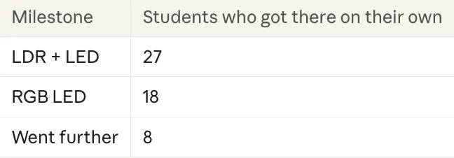
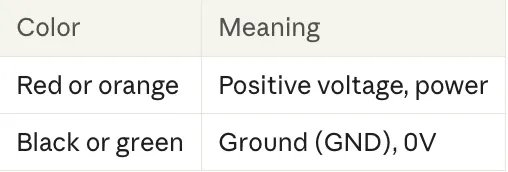
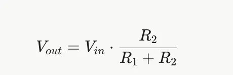
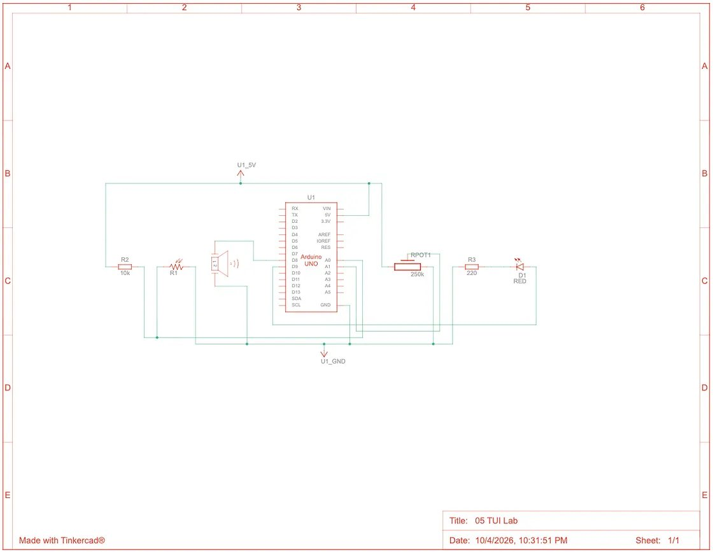
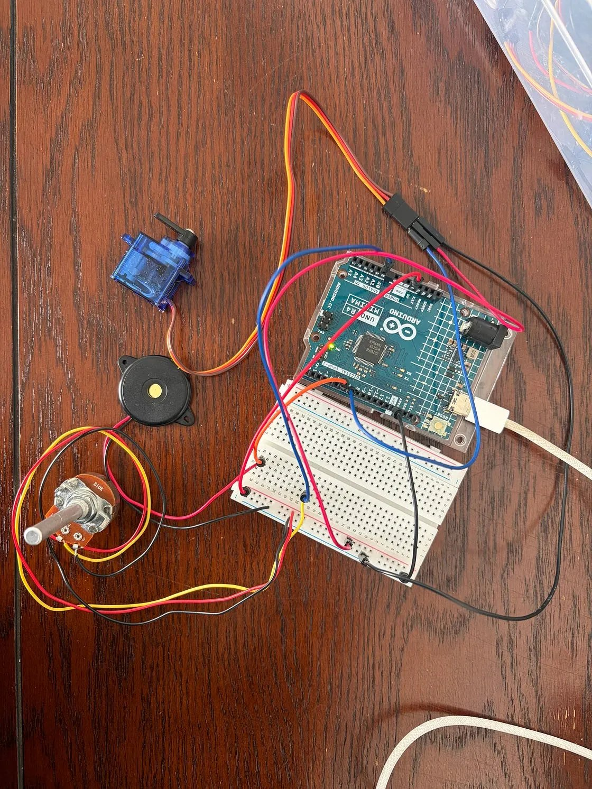

# W2 E1: Reading the board and the voltage divider

**Week 2 · Electronics · Tue Oct 27, 2026**
Lecture: [C17](../../sources/lecture-slides.md) · Published on Medium: [W2 E1](https://medium.com/@cassiusp/w2-e1-tdf-physcomp-f884e30fba15) · Original: [PDF](../../sources/medium-pdfs/W2-E1-tdf-physcomp.pdf)

## Assignment

- Class 17 covered breadboard anatomy, wire color codes, voltage dividers and a soldering tutorial [C17, slides 13 and 19 to 23].
- Journal requirement introduced: 2 entries a week plus 1 diagrammatic analysis of a system per submission [C17, slide 7].
- New homework: "Make 'something interesting' happen with: servo motor; ultrasonic or PIR sensor" [C17, slide 28].

## Journal entry

A quick poll showed where everyone stood after one week of working alone:



_My exercises from last entry put me in the first two rows._

### Reading the board

The lecture went back to basics, and I needed it. A breadboard has three zones:

- Power rails run the full length of each long edge, one red (+) and one blue (minus). They are separate unless you bridge them.

- Terminal strips are short rows of five connected holes, the places where components meet.

- The center divider splits the board, so a strip on one side never touches the strip across from it.

Nearly every wiring bug I hit in my TUI labs lives in that list: a rail nobody bridged, a part sitting in two different strips, a connection that never crossed the divider.

Wire colors are the other half of reading a circuit. Conventions vary (ATX power supplies use yellow for 12V and red for 5V), and TDF adds orange for 3.3V. For now the class rule is simple:



It’s the same lesson as a well-layered architectural drawing. Consistent color is what lets someone else, or you next week, read the board at a glance.

### Diagrammatic analysis: the voltage divider

The last concept of the day explained something I had already used without fully understanding: why every photoresistor needs a 10kΩ partner. It’s also my diagrammatic analysis for this journal submission.

An Arduino’s analog pins read voltage, from 0 to 5V, as a number from 0 to 1023. A photoresistor doesn’t make voltage. It only changes its resistance with light. A voltage divider bridges that gap: two resistors in series between 5V and ground, with the analog pin reading the point between them.

```
5V
|
[LDR ] resistance changes with light
|
+ — — → A0 reads the voltage at this node
|
[10kΩ ] fixed
|
GND
```

The voltage at the middle node depends on how the two resistances compare, where R1 is the top resistor and R2 the bottom one:



If the LDR’s resistance drops, more of the 5V lands across the fixed resistor and the reading changes. Which way it changes depends on whether the LDR sits above or below the node. That detail was the root of a bug in my TUI Lab 05: my code assumed bright light meant a high reading, but the way my divider was wired, it meant a low one. The diagram would have told me before the code did.



### Homework: motion and presence

The tutorial continued, and the new homework moved from light to motion: make something interesting happen with a servo motor and an ultrasonic or PIR sensor, documented with a video, images, code and circuit diagrams.

The two sensors see the world differently. An ultrasonic sensor measures distance by timing an echo, so it knows how far away you are. A PIR sensor detects changes in infrared heat, so it only knows that something warm moved. A servo turns to a set angle on command.

For the servo, I drew on a project from my Tangible User Interfaces class: a cuckoo clock built with my team, where one servo drives both the trap door and the bird. (Adapted from our team project. Elizabeth Wang published the full write-up as “Output: Simple Mechanics” on Medium.)

Driving a servo. A hobby servo has three wires: power, ground and signal. The signal wire goes to an Arduino pin, and the Servo library sends it a target angle with write(). The servo turns to that angle and holds it. That position control is what makes a servo useful for choreography.

The limit that shaped the design. A standard servo sweeps only about 0 to 180 degrees. We wanted a cam to push the bird, but a true cam expects continuous rotation. So the sequence had to fit inside one sweep: the door opens on the way out, the bird follows a few degrees later, and both return on the way back. The timing lives in the code, as a sweep with a pause at the “bird out” angle.

Where the sensor comes in.



### Reflection

This session was mostly review, and that’s why it mattered. In my first week I could make circuits work by copying layouts. Now I can explain why they work: why the rails need bridging, why the colors matter, why a photoresistor needs a partner resistor.

## Sources

- [C17] 2026 TDF - PhysComp class 17 - more Arduino
- [T-ARD] Tewari, Arduino Tutorial
- Original Medium story: https://medium.com/@cassiusp/w2-e1-tdf-physcomp-f884e30fba15
