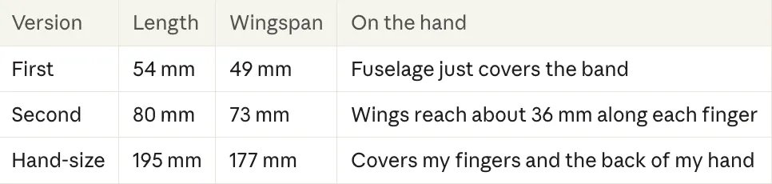
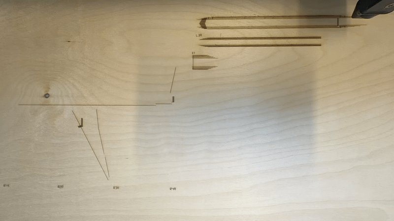
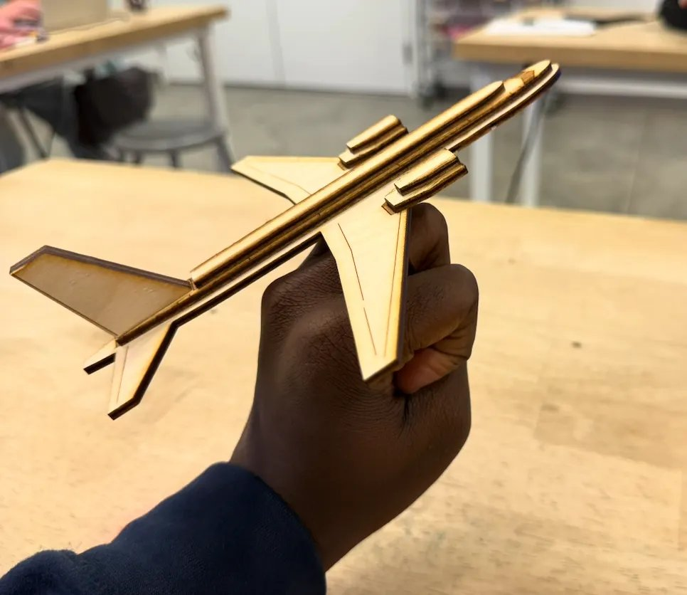
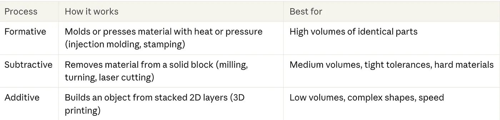
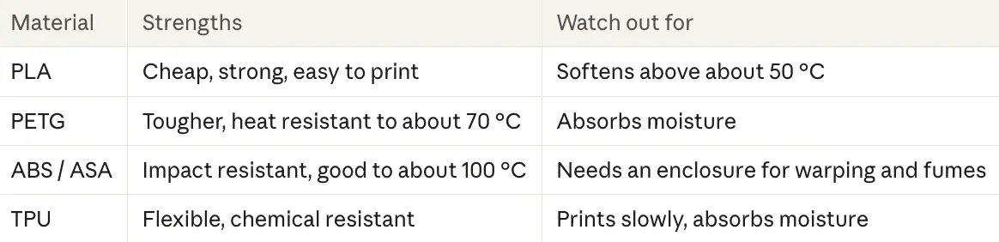
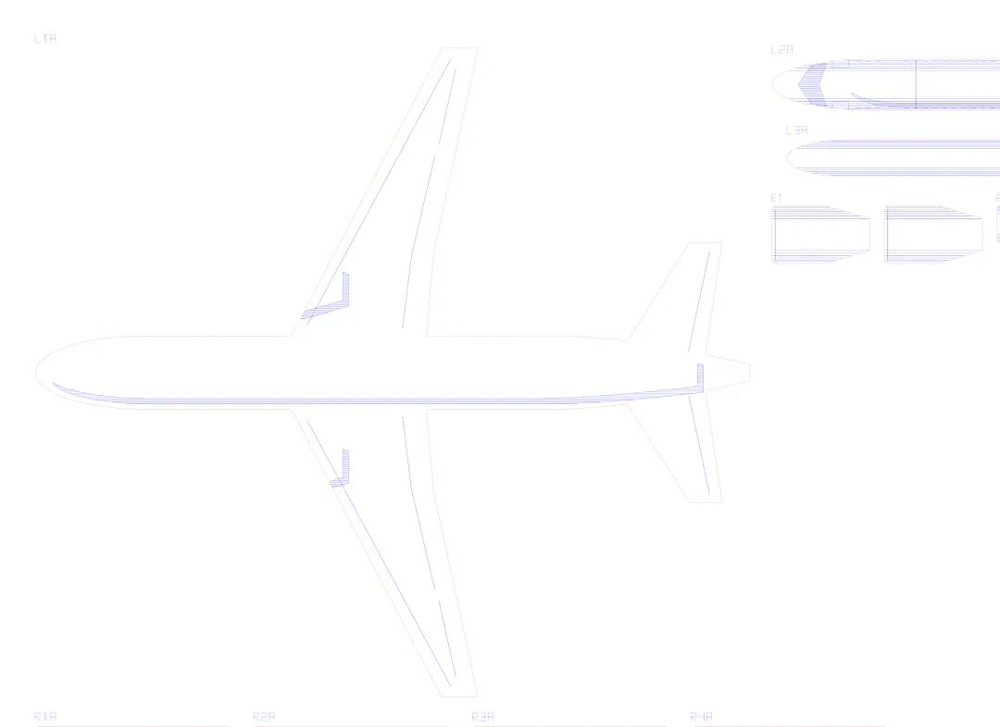
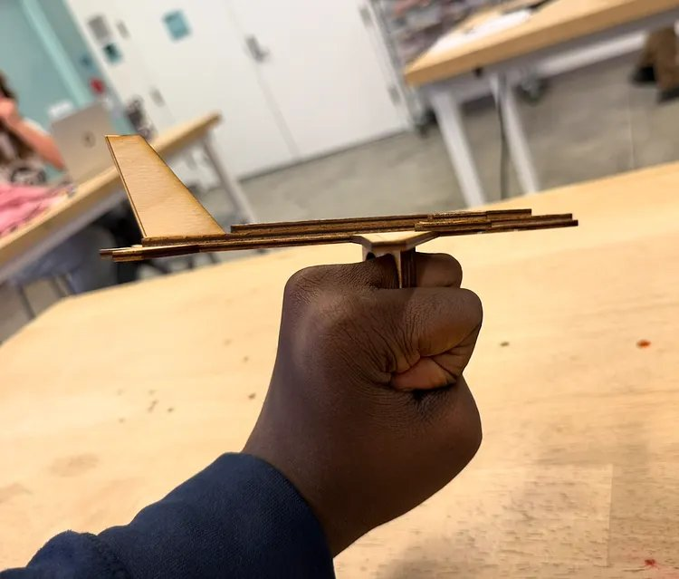

# W2 E2: Ring review, mechanisms and 3D printing

**Week 2 · Fabrication · Thu Oct 29, 2026**
Lecture: [C18](../../sources/lecture-slides.md) · Published on Medium: [W2 E2](https://medium.com/@cassiusp/w2-e2-tdf-physcomp-eac642b391b3) · Original: [PDF](../../sources/medium-pdfs/W2-E2-tdf-physcomp.pdf)

## Assignment

- Laser-cut ring due; add it to the class ring deck for review [C17, slides 25 and 26].
- Lecture: gears and linkages (preview of Expressive Mechanics) and additive manufacturing [C18].
- Next assignment, 3D printed rings: part one recreates the laser-cut ring exactly; part two is a new ring designed for 3DP [C18, slides 52 to 54].

## Journal entry

Thursday was ring day. Everyone brought their laser-cut ring, the class put them all up on slides and voted. Then the session pivoted twice: first to gears and linkages, a preview of the Expressive Mechanics project, then to 3D printing, which turned the ring brief inside out.

### The ring review: a 737 across two fingers

My entry for the review was the two-finger 737 from my last entry. Getting it from concept to cut took three decisions.

Fit. I measured my finger at 2.70 inches around, which works out to a hole about 21.8 mm across. The laser burns away roughly 0.15 mm of kerf, so fit-critical edges were offset to compensate. I didn’t fully trust the math, so a fit test strip with holes at 21.3, 21.8 and 22.3 mm went on the sheet to cut first.

The file. My first file used four kinds of marks: red cuts, blue scores, green etches and gray gradient fills. The shop takes red and blue only. Losing the gradients meant drawing the fuselage’s roundness instead: rows of scored lines packed tighter toward the edges, which is hatching done by a laser.

Scale. The brief said make it big, so I did:

Scale paid for itself in detail. The fuselage now steps down in three layers (20, 14 and 10 mm wide), the windows became individual scored dashes, and doors and overwing exits appeared. It also had costs: a four-plate band about 12.7 mm wide, an optional fin 43 mm tall, one ring per sheet, and no fist while wearing it.

### Gears and linkages: how a mechanism gets made

The gears and linkages section previewed Expressive Mechanics through one maker’s process, Mo’s, step by step:

1. Sketch first, with notations and callouts. The drawing is where dimensions get decided.

2. Go low fidelity. Popsicle sticks, string and a jar lid were enough to check that a motion works at all.

3. Quick fabrication. Foam board and tape tested the full layout with a real motor in place.

4. Add components. Cardboard arms, discs and slots, cut fast and cheap.

5. Laser cut the final parts in plywood, plus extras, because something always breaks.

6. 3D print what flat sheet can’t do, like motor mounts and drive shaft adapters.

7. Test tolerance. A strip of quarter-inch holes from 0.23 to 0.26 inches shows exactly which size gives a dowel a free spin and which one binds.

8. Sand everything first. Smooth edges cut friction before assembly.

The Expressive Mechanics brief compresses that into a loop: test, tolerance, build, sand, repeat. The design advice was equally short. Build one simple mechanism, then repeat it. Complexity comes from repetition, not from one clever part.

### 3D printing, from the beginning

The second half opened with a pop quiz on the three ways to make a physical object:

_That last row describes my ring exactly. I built a volume from stacked flat layers, by hand, on a subtractive machine._

Who invented it? It’s complicated. Chuck Hull usually gets the credit, but the history is crowded:

**1981**  
Hideo Kodama in Japan receives the first patent for a device that cures  
photopolymer with UV light  
**1984**  
French inventors Alain Le Méhauté, Olivier de Witte and Jean Claude André file a  
patent, later abandoned for having no economic future  
**1984**  
Chuck Hull patents stereolithography (SLA)  
**1987**  
Hull invents the STL file format and founds 3D Systems  
**1987**  
Carl Deckard files a patent for selective laser sintering (SLS)  
**1989**  
S. Scott Crump patents fused deposition modeling (FDM) and co-founds Stratasys  

The abandoned French patent is the detail I keep thinking about. An invention can be right and still arrive before anyone knows what it’s for.

What we print with. The class/studio uses FDM, which melts thermoplastic filament and lays it down layer by layer.

_Settings for success: go big, use layer heights of 0.20 mm or more, skip high-resolution prints, keep infill under 15% and add a brim for bed adhesion. The underlying rule is design for additive manufacturing: a part drawn for a laser cutter or a mill won’t use what a printer does best._

### The next brief: the ring, printed

The homework brings it all together in two parts:

- Part one: recreate the laser-cut ring for 3D printing. Import the Illustrator file into Fusion 360, extrude it to match the plywood, and print an exact copy. Whatever comes out is what gets turned in, because the point is to see the difference between the two machines.

- Part two: design a second ring for 3D printing. No wall thinner than 1.5 mm, no detail smaller than 1 mm. Go big.

For the 737, part one raises real questions. My stacked plywood layers could print as one solid body, but the scored lines have no equivalent: a printer can’t score, so every window and panel seam would have to become raised or recessed geometry. The 1 mm detail rule replaces the laser’s 2 mm limit, which helps the wingtips. And the brim and layer-height rules matter more on a part this large.

### Reflection

The through-line of this session was translation between machines. My ring was an additive idea, a stack of layers, built on a subtractive machine. Now the brief asks me to carry it to an additive one and watch what survives.

Mo’s process gave me a vocabulary for that. Sketch, go low fidelity, test tolerance, sand, repeat. Going into Expressive Mechanics, I want to treat every joint and every hole that way: assume the first size is wrong and cut a strip to prove it.

## Sources

- [C18] 2026 TDF - PhysComp class 18 - 3DP & Additive Manufacturing
- [T-PRUSA] PrusaSlicer UI overview
- Original Medium story: https://medium.com/@cassiusp/w2-e2-tdf-physcomp-eac642b391b3
