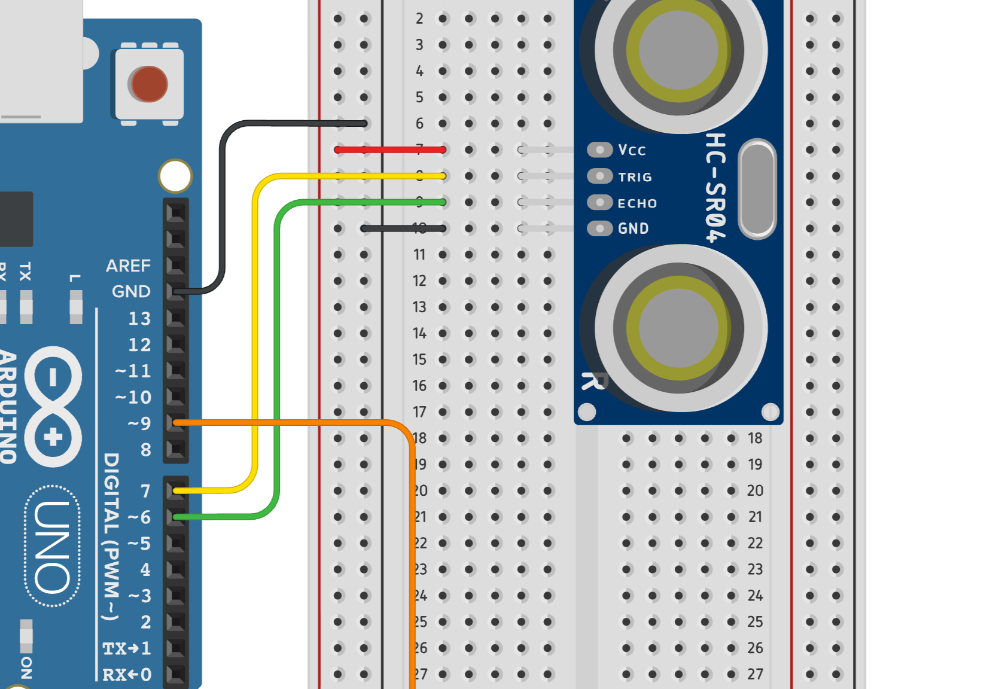

# W3 E1: Personal space, a PIR build and an ultrasonic sign

**Week 3 · Electronics · Tue Nov 3, 2026**
Lecture: [C19](../../sources/lecture-slides.md) · Tinkercad: [Personal Space Servo](https://www.tinkercad.com/things/iATx6h2WW2H-personal-space-servo)

## Assignment

"Make 'something interesting' happen with: servo motor; ultrasonic or PIR sensor. Document this work in your design journal: 1 video + some images, code files + circuit diagrams, a short write-up of your experiments and the results" [C17, slide 28].

## What I did

I explored the prompt with both sensors, around one idea: a servo that reacts to someone entering your personal space.

**Physical build: PIR + servo.** On the kit's Arduino Uno, I wired a PIR motion sensor to a micro servo so that someone walking into view makes the servo turn. I built it and brought it to class on Tuesday, November 3, but I forgot to document the process entirely: no photos, no video, no saved code. Given my time constraints I won't be reconstructing it, so the PIR build isn't documented below, and the Tinkercad version stands as the record of this exercise.

**Tinkercad build: the Personal Space Servo (ultrasonic).** In Tinkercad I built the same idea with the ultrasonic distance sensor (HC-SR04) instead. The servo horn acts as a sign:

- Nobody within 50 cm: the sign lies horizontal (0°).
- Someone closer than 50 cm for half a second: the sign stands vertical (90°) and gives a warning shake of 15° each way.
- Once they back off for a full second, the sign eases back down.

The code smooths the distance readings and adds 5 cm of hysteresis at the boundary, so the sign doesn't flicker when someone stands right at the edge. The two delays give it a little patience: a passer-by doesn't trigger it, and it doesn't drop the moment you step back.

## Media




<!-- Video: screen-record the Tinkercad simulation (Start Simulation, click the sensor, drag the target inside 50 cm) and add it here:
[Video: Personal Space Servo simulation](media/personal-space-servo-sim.mp4) -->

## Code and circuit

| Part | Pin | Arduino |
|---|---|---|
| HC-SR04 | VCC | 5V |
| HC-SR04 | TRIG | Digital pin 7 |
| HC-SR04 | ECHO | Digital pin 6 |
| HC-SR04 | GND | GND |
| Micro servo | PWR (red) | 5V |
| Micro servo | SIG (orange) | Digital pin 9 |
| Micro servo | GND (brown) | GND |


Full sketch: [`code/personal_space_servo.ino`](code/personal_space_servo.ino), copied from the Tinkercad design.

```cpp
const int TRIG_PIN = 7;
const int ECHO_PIN = 6;
const int SERVO_PIN = 9;

const int PRESENCE_CM = 50;    // closer than this counts as "too close"
const int HYSTERESIS = 5;      // keeps it from flickering at the edge

const unsigned long ENTER_DELAY_MS = 500;   // must stay close this long before it reacts
const unsigned long EXIT_DELAY_MS = 1000;   // holds the sign up this long after you leave

const int ANGLE_IDLE = 0;        // horizontal
const int ANGLE_TOO_CLOSE = 90;  // vertical
const int SHAKE_AMOUNT = 15;     // degrees each way for the warning shake
```

## Results and reflection

Working with both sensors showed me how much the choice of sensor decides what a machine can know. The PIR asks only whether anyone is there, so my class build could switch between two states but never track a person. The ultrasonic sensor measures how far away you are, which let the Tinkercad version draw a line: 50 cm becomes a boundary, and crossing it is what the sign reacts to.

The timing turned into behavior. The PIR holds its signal for a few seconds after motion stops, so the servo lingered before relaxing. In the Personal Space Servo I designed that delay on purpose: half a second before it reacts, a full second before it relaxes. Those two numbers are what make it read as a polite warning rather than a twitchy alarm.

The lesson I'm keeping is about documentation. I brought the PIR build to class without documenting any of it, and rather than rebuild it on a tight schedule, I'm letting the Tinkercad version stand as the record. Next time the phone comes out before the breadboard does.

_AI use: drafted with Claude from my build notes, Tinkercad design and code, then reviewed by me [C01, slide 46]._

## Sources

- [C19] 2026 TDF - PhysComp class 19 - Project 1 intro - p5.js
- [C17] class 17 deck, servo + sensor homework slide and wire color codes
- Tinkercad design: [Personal Space Servo](https://www.tinkercad.com/things/iATx6h2WW2H-personal-space-servo) (private)
