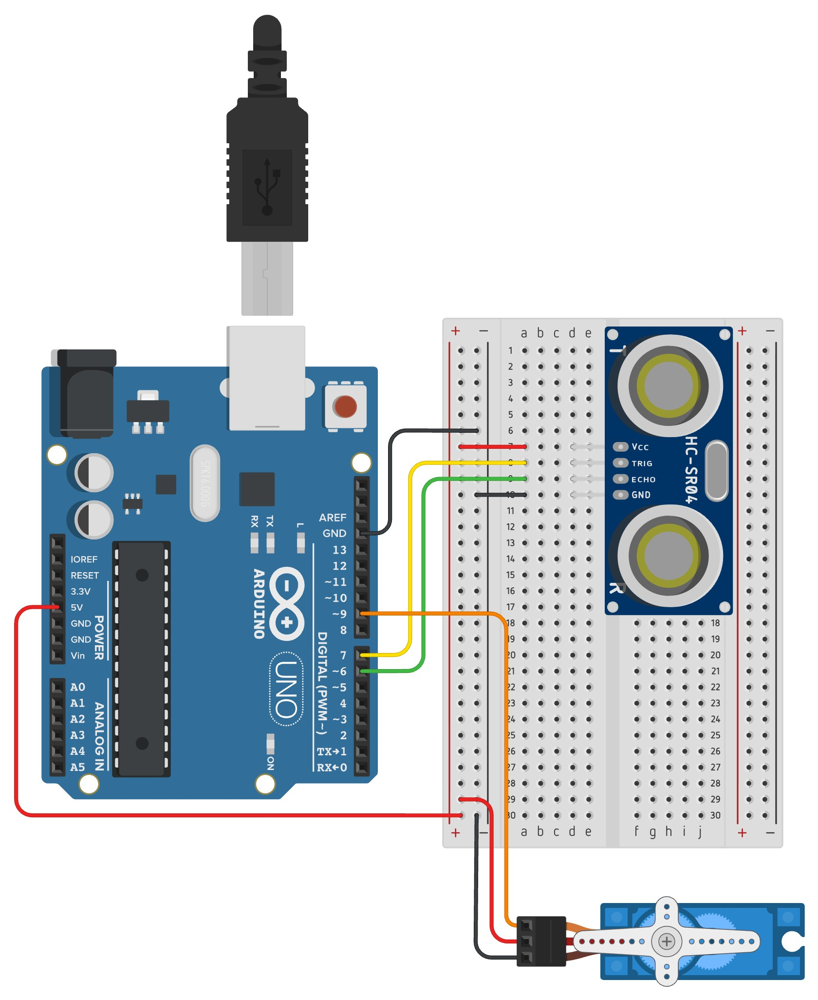
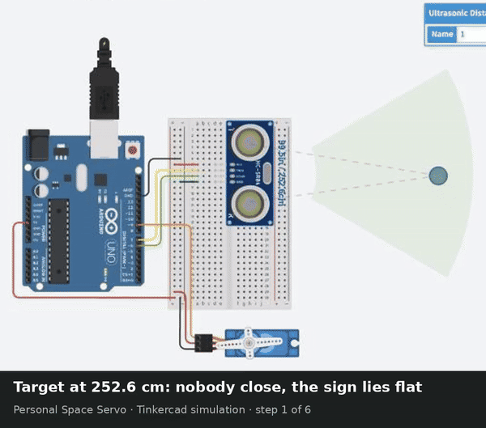

# W3 E1: The Personal Space Servo

**Week 3 · Electronics · Tue Nov 3, 2026**
Lecture: [C19](../../sources/lecture-slides.md) · Tinkercad: [Personal Space Servo](https://www.tinkercad.com/things/iATx6h2WW2H-personal-space-servo)

## Assignment

"Make 'something interesting' happen with: servo motor; ultrasonic or PIR sensor. Document this work in your design journal: 1 video + some images, code files + circuit diagrams, a short write-up of your experiments and the results" [C17, slide 28].

## What I did

I chose the ultrasonic sensor and built around one idea: a servo that reacts when someone steps into your personal space. The servo horn acts as a sign:

- Nobody within 50 cm: the sign lies horizontal (0°).
- Someone closer than 50 cm for half a second: the sign stands vertical (90°) and gives a warning shake of 15° each way.
- Once they back off for a full second, the sign eases back down.

The code smooths the distance readings and adds 5 cm of hysteresis at the boundary, so the sign doesn't flicker when someone stands right at the edge. The two delays give it a little patience: a passer-by doesn't trigger it, and it doesn't drop the moment you step back.

I designed and simulated it in Tinkercad first, then built it on the kit's Arduino Uno with the HC-SR04 ultrasonic sensor and a micro servo, and brought it to class on Tuesday, November 3. I forgot to document the physical build entirely: no photos or video. Given my time constraints I won't be reconstructing it, so the Tinkercad design, which the physical build followed, stands as the record below.

## Media






[Video: Personal Space Servo simulation (MP4, 15 s)](media/personal-space-servo-sim.mp4). In the Tinkercad simulation, the target moves from 252.6 cm to 133.7 cm (sign stays flat), then to 27 cm (after half a second the sign stands up and shakes), then back out past 50 cm (the sign holds for a second, then lowers).

## Code and circuit

| Part | Pin | Arduino |
|---|---|---|
| HC-SR04 | VCC | 5V |
| HC-SR04 | TRIG | Digital pin 7 |
| HC-SR04 | ECHO | Digital pin 6 |
| HC-SR04 | GND | GND |
| Micro servo | PWR (red) | 5V |
| Micro servo | SIG (orange) | Digital pin 9 |
| Micro servo | GND (brown) | GND |


Full sketch: [`code/personal_space_servo.ino`](code/personal_space_servo.ino), copied from the Tinkercad design.

```cpp
const int TRIG_PIN = 7;
const int ECHO_PIN = 6;
const int SERVO_PIN = 9;

const int PRESENCE_CM = 50;    // closer than this counts as "too close"
const int HYSTERESIS = 5;      // keeps it from flickering at the edge

const unsigned long ENTER_DELAY_MS = 500;   // must stay close this long before it reacts
const unsigned long EXIT_DELAY_MS = 1000;   // holds the sign up this long after you leave

const int ANGLE_IDLE = 0;        // horizontal
const int ANGLE_TOO_CLOSE = 90;  // vertical
const int SHAKE_AMOUNT = 15;     // degrees each way for the warning shake
```

## Results and reflection

Choosing the ultrasonic sensor over the PIR changed what the machine could know. A PIR only senses that something warm moved, so a servo driven by it can only switch on and off. The ultrasonic sensor measures how far away you are, which let me draw a line: 50 cm becomes a boundary, and crossing it is what the sign reacts to.

The timing turned into behavior. Half a second before it reacts and a full second before it relaxes are what make it read as a polite warning rather than a twitchy alarm. The hysteresis matters for the same reason: without it, someone standing right at 50 cm would make the sign stutter up and down.

Simulating in Tinkercad first let me tune those numbers before touching hardware. The lesson I'm keeping is about documentation. I brought the build to class without recording any of it, and rather than rebuild it on a tight schedule, I'm letting the Tinkercad version stand as the record. Next time the phone comes out before the breadboard does.

## Sources

- [C19] 2026 TDF - PhysComp class 19 - Project 1 intro - p5.js
- [C17] class 17 deck, servo + sensor homework slide and wire color codes
- Tinkercad design: [Personal Space Servo](https://www.tinkercad.com/things/iATx6h2WW2H-personal-space-servo) (private)
