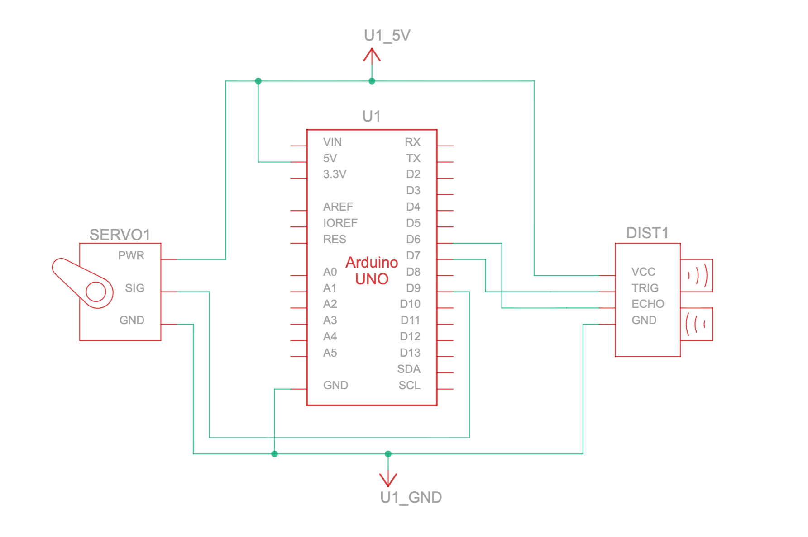

# W3 E1: Motion, detected: a PIR sensor that moves a servo

**Week 3 · Electronics · Tue Nov 3, 2026**
Lecture: [C19](../../sources/lecture-slides.md) · Medium article: _add link_

## Assignment

"Make 'something interesting' happen with: servo motor; ultrasonic or PIR sensor. Document this work in your design journal" [C17, slide 28].

## What I did

I wired a PIR motion sensor to a servo so that a person walking into view makes the machine physically react. I built and demoed it in class on Tuesday, November 3.

I picked the PIR because it answers a more human question. A distance sensor asks *how far away are you?* A PIR asks *is anyone here?*

**Circuit.** Three kit parts: Elegoo Arduino Uno R3, PIR motion sensor, micro servo, all on the Arduino's 5V rail. Prototyped in Tinkercad first, then built on a breadboard. Red jumpers carry 5V and black carry ground, per the class color code [C17, slide 21].

| Part | Pin | Arduino |
|---|---|---|
| PIR sensor | VCC | 5V |
| PIR sensor | GND | GND |
| PIR sensor | OUT | Digital pin _[#]_ |
| Micro servo | Red | 5V |
| Micro servo | Brown | GND |
| Micro servo | Orange (signal) | Digital pin _[#]_ |

**Code.** A loop that asks one question: is the PIR's output HIGH? On motion, the servo turns to its alert angle; when motion stops, it returns to rest. The sketch prints the sensor state to the Serial Monitor. A PIR only outputs on or off and holds HIGH for a few seconds after motion stops, so the servo can't track *where* you are, only *that* you are.

**Documentation note.** I didn't capture photos or video of the physical build in class, and it has since been taken apart. The Tinkercad model and code below are the design the hardware was built from.

## Media

<!-- Tinkercad breadboard screenshot, schematic export, screen recording of the simulation:

[Video: simulation](media/pir-servo-sim.mp4) -->

## Code and circuit

<!-- Put pir_servo.ino in ./code. The wiring table above plus the Tinkercad schematic count as the circuit diagram. -->

## Results and reflection

<!-- Your own words. Starting points from the Medium draft: presence vs. proximity; the PIR hold time reads like hesitation; simulating first caught mistakes. -->

## Sources

- [C19] 2026 TDF - PhysComp class 19 - Project 1 intro - p5.js
- [C17] class 17 deck, servo + sensor homework slide and wire color codes
