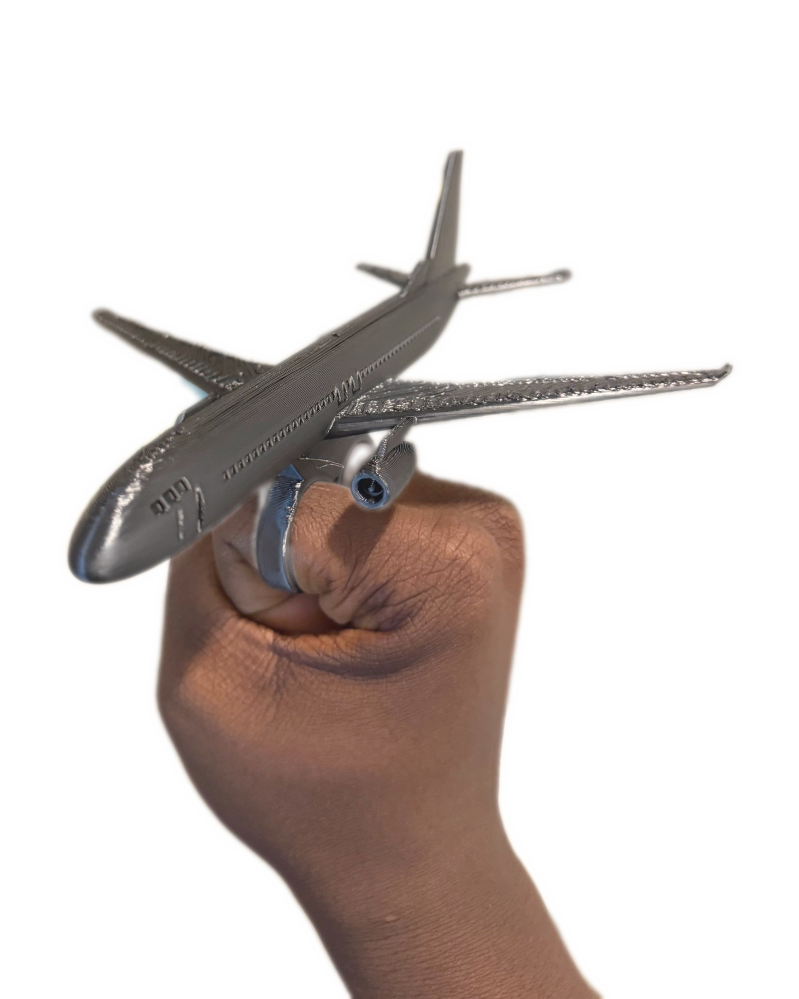
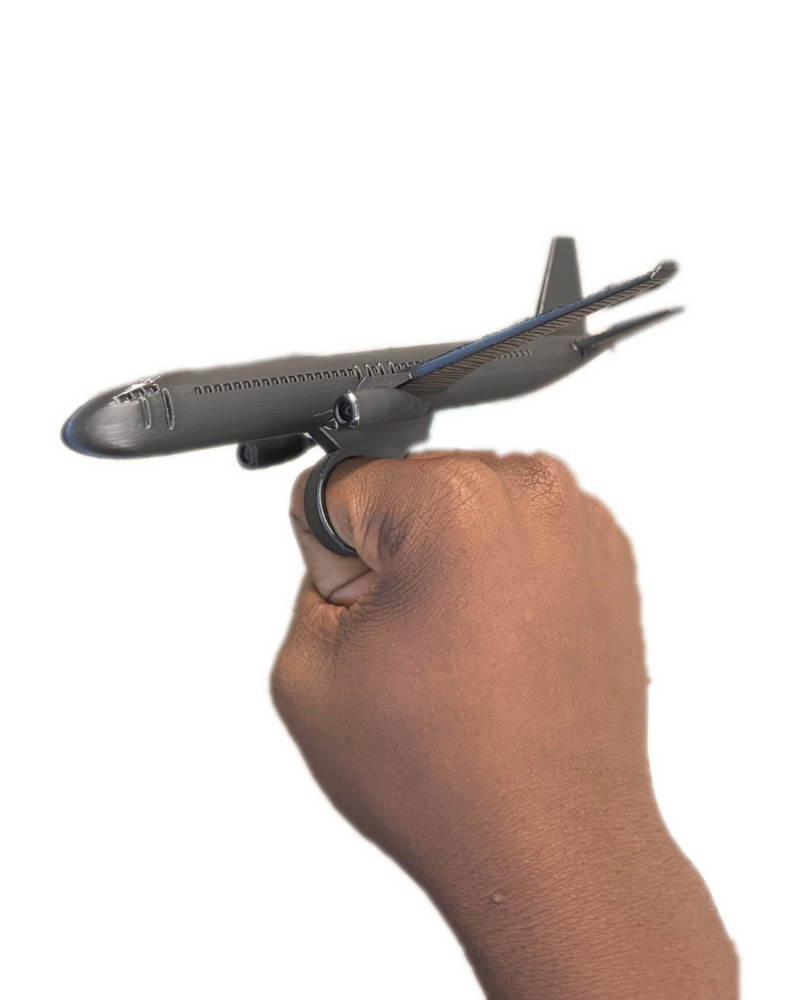
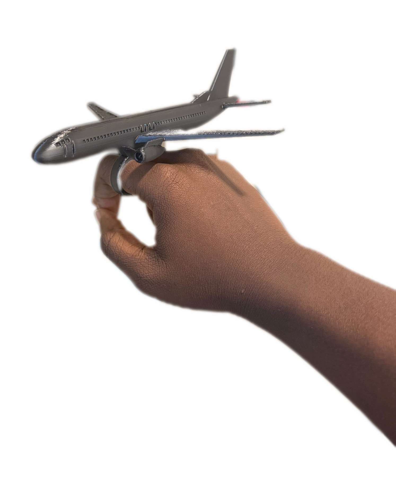

# W3 E2: 3D printing the 737 ring

**Week 3 · Fabrication · Thu Nov 5, 2026**
Lecture: [C20](../../sources/lecture-slides.md) · Assignment from [C18](../../sources/lecture-slides.md)

## Assignment

- **Part one:** "Recreate your lasercut ring for 3DP. Try and print an exact copy of your laser cut ring... however it prints that's what you turn in. (We want to see the difference between laser and 3DP.)" Suggested method: import the Illustrator file into Fusion 360 and extrude 3 mm [C18, slides 52 and 53].
- **Part two:** a second ring designed for 3DP. No wall under 1.5 mm, no detail under 1 mm. "Be creative, be experimental, be bold" [C18, slides 54 to 57].
- Add 3D printed ring photos to the class deck [C19, slide 26].
- In class: rings shown and voted on [C20, slides 3 and 4]; gears and linkages, from sketch to tolerance test [C20, slides 5 to 23]; servos and pushrod connections [C20, slides 28 to 35; T-PUSH]; Expressive Mechanics sketch share-out [C20, slide 36].

## What I did

Part two became a volumetric 737 on a two-finger band, printed in dark gray filament: fuselage with window and door detail, swept wings, engines on pylons, and a full tail.

<!-- Add: part one (the flat extrusion) and how it compared with the laser-cut version; modelling tool; print settings (layer height, infill, supports, brim); print time; failures and fixes. -->

## Media

Photos are cut out onto white with a soft color grade.

<!-- Required video: a short clip turning the ring in your hand works. -->

## Code and circuit

Not applicable (fabrication entry). Put the STL or 3MF in ./code.

## Results and reflection

<!-- Your own words: laser vs. 3DP, what the layer lines and supports did to the wing surfaces, fit on two fingers. -->

## Sources

- [C18] 2026 TDF - PhysComp class 18 - 3DP & Additive Manufacturing
- [C19] class 19 deck, ring photo homework slide
- [C20] 2026 TDF - PhysComp class 20 - Servos and More
- [T-PUSH] Adafruit, Pushrod Garage
