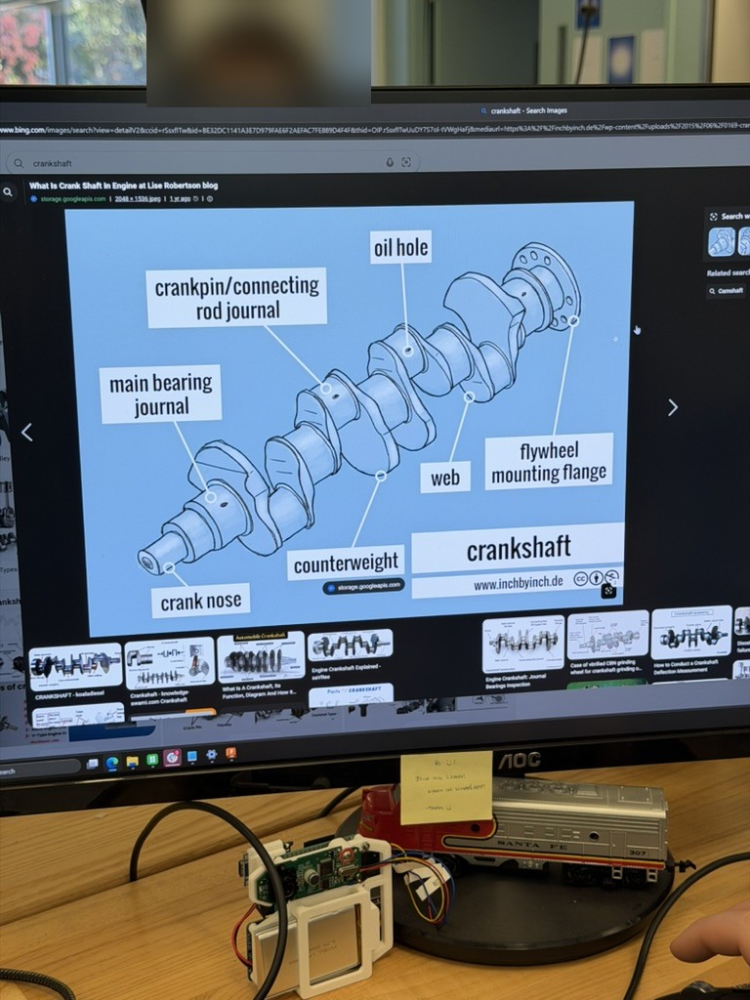
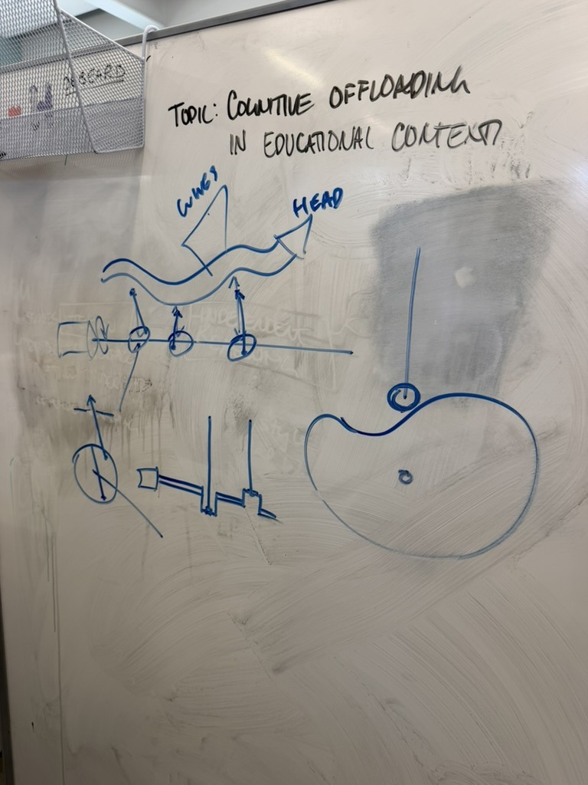
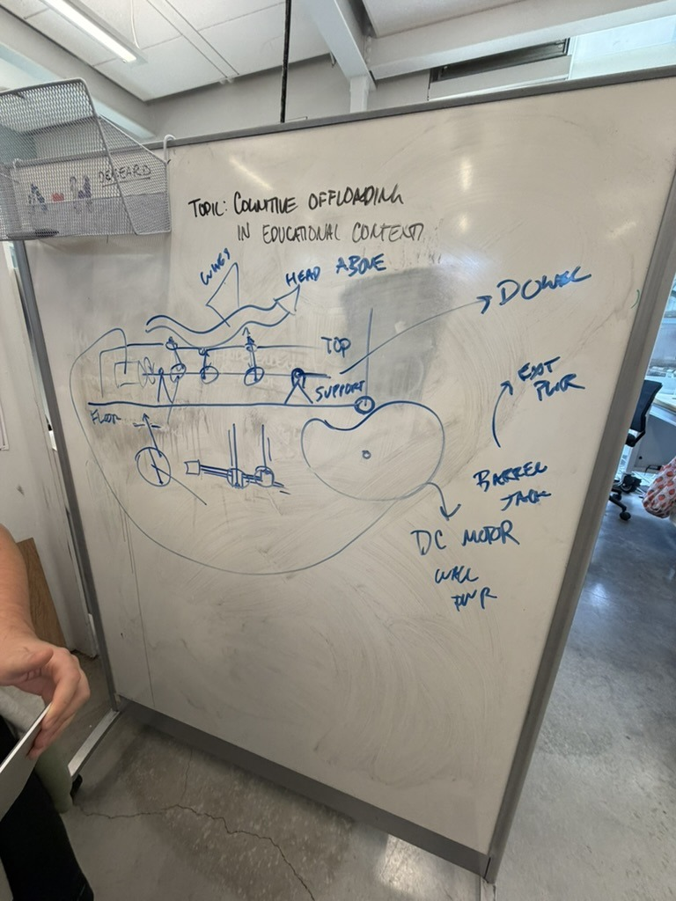
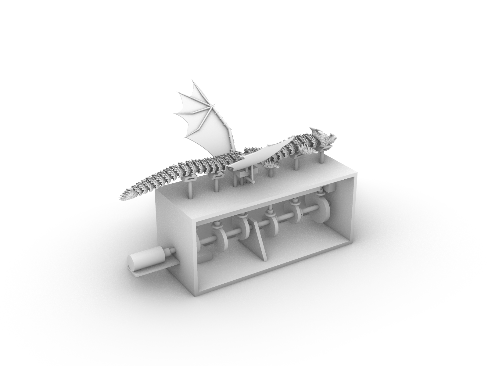
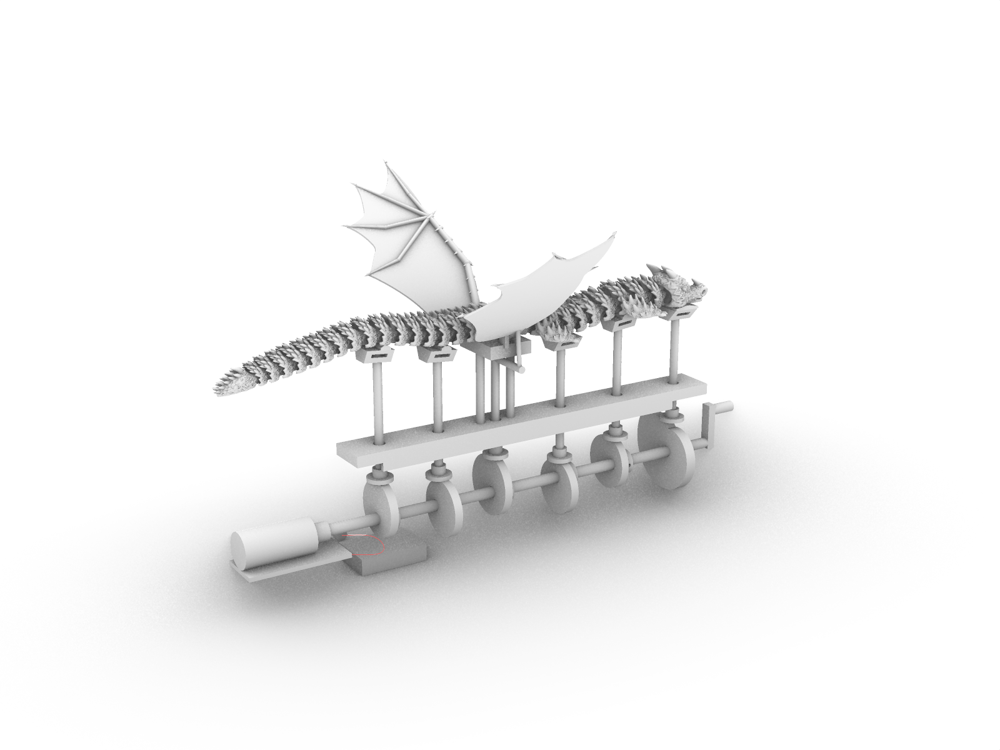
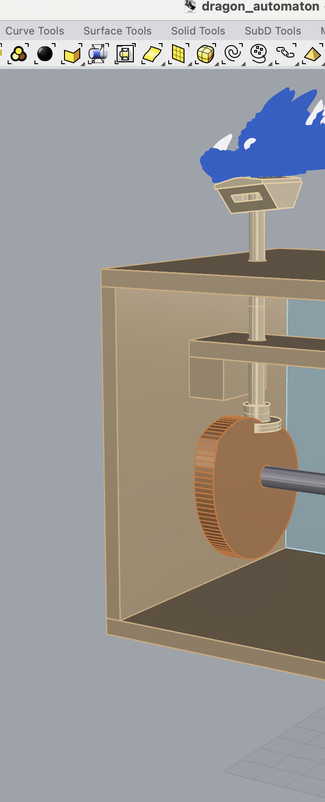
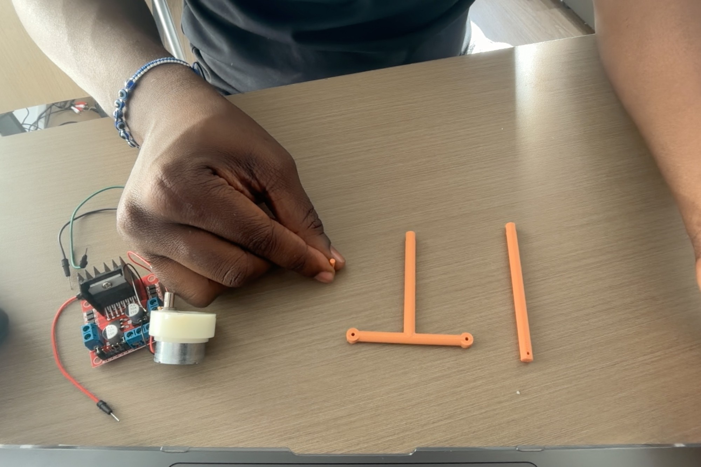
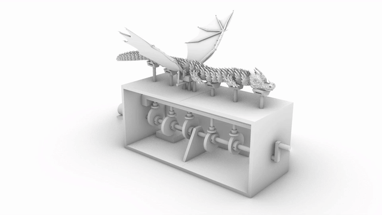
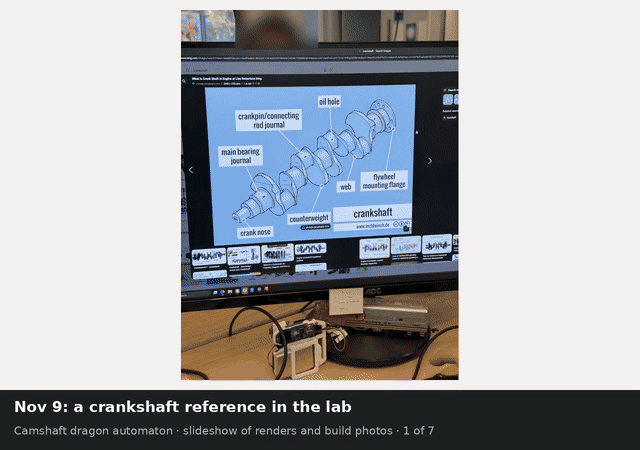

# W4 E1: Expressive Mechanics, the camshaft dragon automaton

**Week 4 · Project · Nov 9 to 11, 2026**
Lecture: [C19](../../sources/lecture-slides.md) · Full build repo: [turntable-dragon](https://github.com/cassiusp-beep/turntable-dragon)

## Assignment

Project 1, Expressive Mechanics: "Give the machine emotions." A kinetic sculpture with (electro)mechanical movement from a servo, DC motor + H-bridge, or solenoid, controlled with computer vision through Arduino + p5.js [C19, slides 9 and 10; B-EM]. Reference artists: Neil Mendoza, Reuben Margolin [C19, slide 9]. Due Thu Nov 12.

## What I did

**Concept (Nov 9).** A classic automaton: a hand crank or motor turns a camshaft, and cams under a printed dragon push rods up and down so a wave runs along its body from tail to head. Wings flap, and a snail cam lifts the head slowly and drops it.

**Build (Nov 9 to 11).**
- Modelled the whole machine parametrically in Rhino with Python (`dragon_automaton.py`). Every clearance lives in one `FIT_*` block, checked against a printed fit-test ladder.
- Box: laser-cut 1/8 in plywood with finger joints and an acrylic front window.
- Mechanism: six cams (tail, back, belly, neck, wing, head snail cam) drive push rods holding printed cradles that carry a 125%-scale D3Craft Flexi Dragon. Wings scripted in `wing_concepts.py`.
- Prints split across 8 plates; even the camshaft was printed (8 mm D-shaft, 100% infill).
- Electronics from the kit: Elegoo Uno R3, L298N H-bridge, Mini-300 gearmotor.

**Why it was dropped (Nov 11 to 12).**
- The 1.75 mm filament hinge pins didn't fit the small hinge holes on plate 4.
- The shaft jammed. A 10-degree-step sweep in Rhino found the head push rod's foot hitting the right guide block for most of the turn and rising about 2 mm into the guide bar at the top of the snail cam. A reprinted guide bar with a clearance pocket and a trimmed foot didn't free it.
- Six cams, six rods, cradles, wing linkages and a two-piece shaft all had to line up within fractions of a millimetre, with a demo the next day.

## Media

| Crankshaft reference | Whiteboard sketch | Annotated sketch |
|---|---|---|
|  |  |  |

| In the box | Mechanism | Rhino work in progress |
|---|---|---|
|  |  |  |

[Video: camshaft automaton, Rhino animation (MP4, 6 s)](media/camshaft-automaton-animation.mp4). One full camshaft revolution in 36 steps of 10°, rendered in Rhino from `dragon_automaton.py`: the cams lift the push rods so the wave runs along the dragon, and the wing cam flaps the wings. The physical build jammed, so this shows the motion as designed. Animated through the Rhino MCP with Claude Code.

[Video: camshaft automaton slideshow (MP4, 20 s)](media/camshaft-automaton-slideshow.mp4). There's no footage of the automaton running, since it jammed before it could turn freely, so this is a captioned slideshow of the reference, sketches, Rhino model, renders and build photos, in the order the design developed.

## Code and circuit

- CAD generators: [`dragon_automaton.py`](https://github.com/cassiusp-beep/turntable-dragon/blob/main/dragon_automaton.py), [`wing_concepts.py`](https://github.com/cassiusp-beep/turntable-dragon/blob/main/wing_concepts.py), [`laser_box_fingers.py`](https://github.com/cassiusp-beep/turntable-dragon/blob/main/laser_box_fingers.py)
- Circuit: Uno R3 PWM into the L298N H-bridge driving the gearmotor. See the system diagram in the [diagrammatic analysis](../2026-11-12-w4-analysis/README.md).

## Results and reflection

I went into Expressive Mechanics planning to follow Mo's process: assume the first size is wrong and test it. I did, with a printed fit-test ladder and every clearance in one FIT block, and the automaton still jammed. The Rhino sweep found why: the head push rod's foot hit the guide block for most of the turn. A reprinted guide bar and a trimmed foot didn't free it.

The real lesson was tolerance stacking. Six cams, six rods, cradles, wing linkages and a two-piece printed shaft all had to line up within fractions of a millimeter. Each part could be within tolerance and the machine could still bind, because the errors add up. The brief's advice, build one simple mechanism and repeat it, was the advice I hadn't taken.

I'd keep the parametric approach. Driving the whole model from Python made it fast to diagnose and reprint, and it's why I could pivot overnight.

## Sources

- [R-DRAGON] Palacio, [turntable-dragon](https://github.com/cassiusp-beep/turntable-dragon) repository: CAD, firmware, interaction code and build notes
- [C19] 2026 TDF - PhysComp class 19 - Project 1 intro - p5.js
- [B-EM] Expressive Mechanics brief
- Flexi Dragon by D3Craft (MakerWorld, Standard Digital File License)
- CAD and code developed with Claude Code
