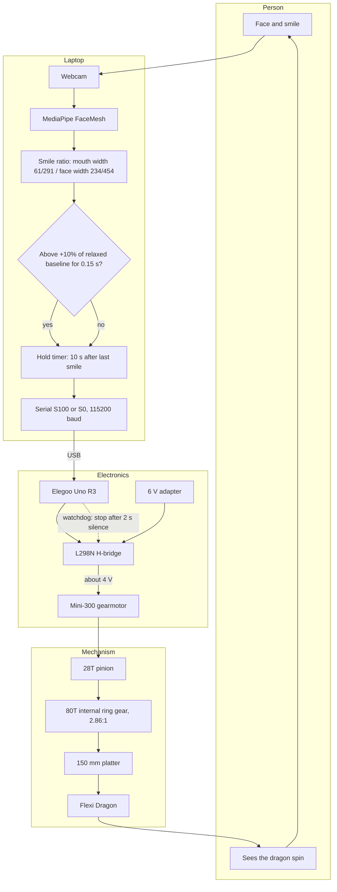

# W4 analysis: the turntable dragon as a system

**Required once per journal submission** [C17, slide 7]. This one covers the Project 1 submission.

The diagram follows one smile from face to motion: sensing, interpretation, a timer that holds the state, power conversion, and a mechanical reduction. Feedback runs through the person, who sees the dragon move and smiles again.

<!-- Optional: export this as an image (or redraw it by hand) and add your own annotations about where the system can fail: no face in view, weak USB power, IN2 not reaching the H-bridge. -->

## Sources

- [C17] class 17 deck, journal requirements (diagrammatic analysis)
- System details from the [turntable-dragon](https://github.com/cassiusp-beep/turntable-dragon) README
