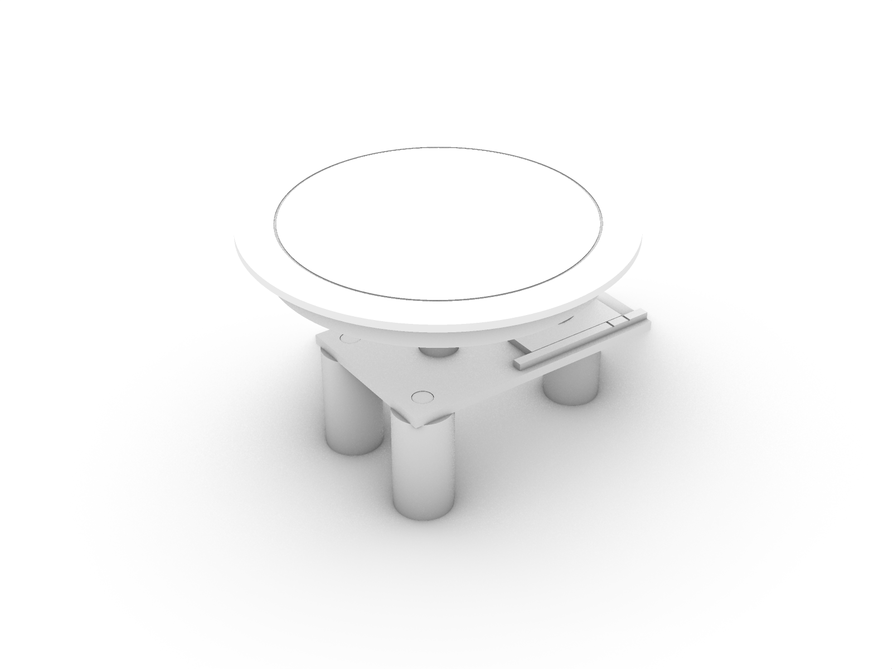
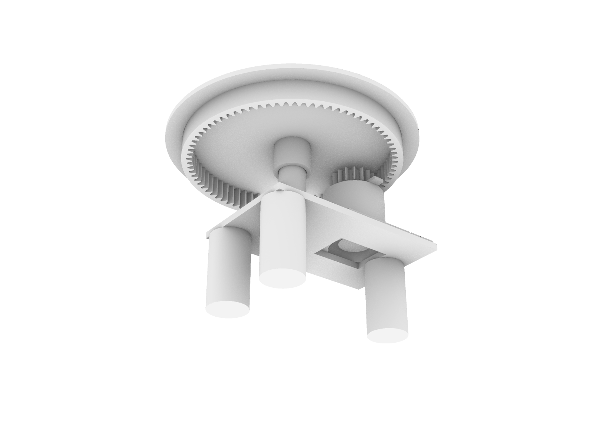
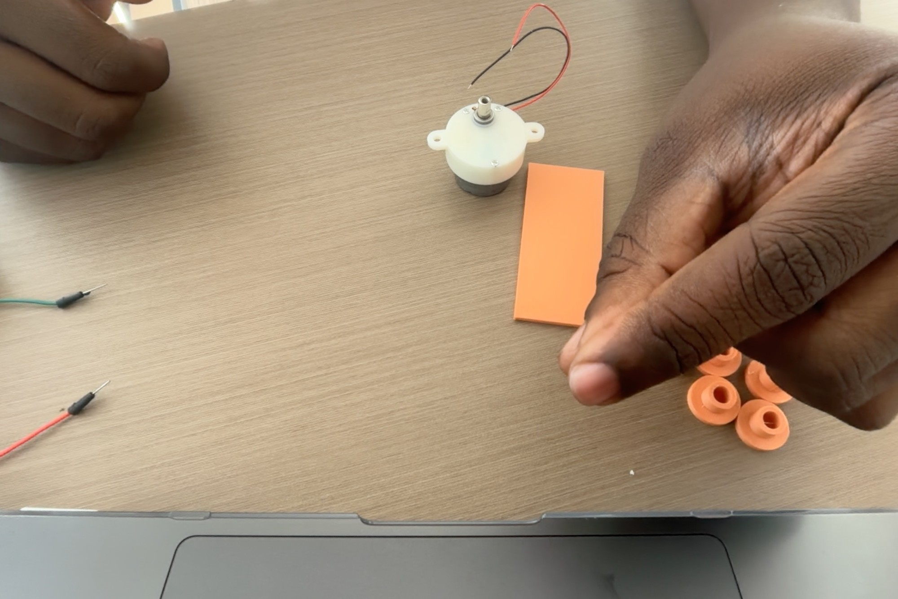
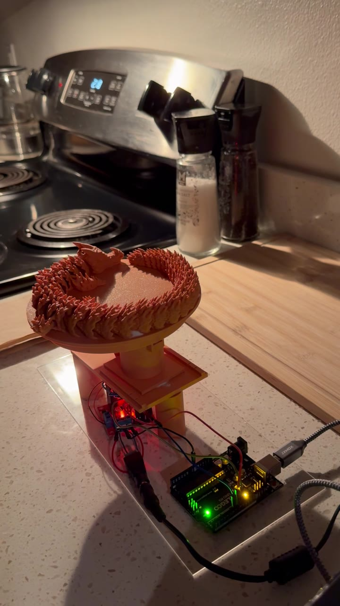
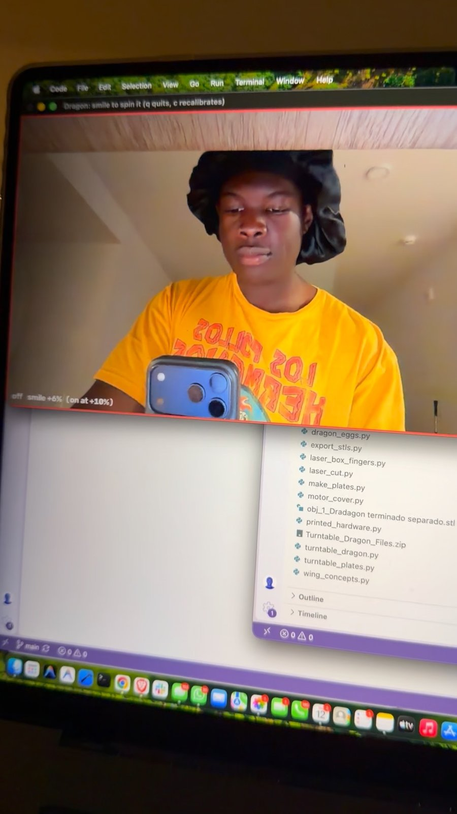
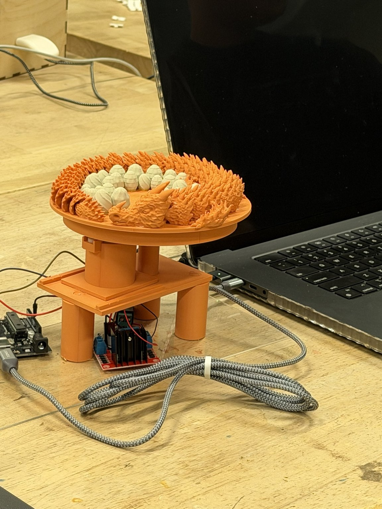
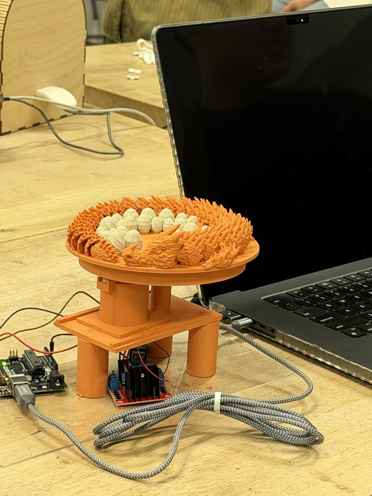
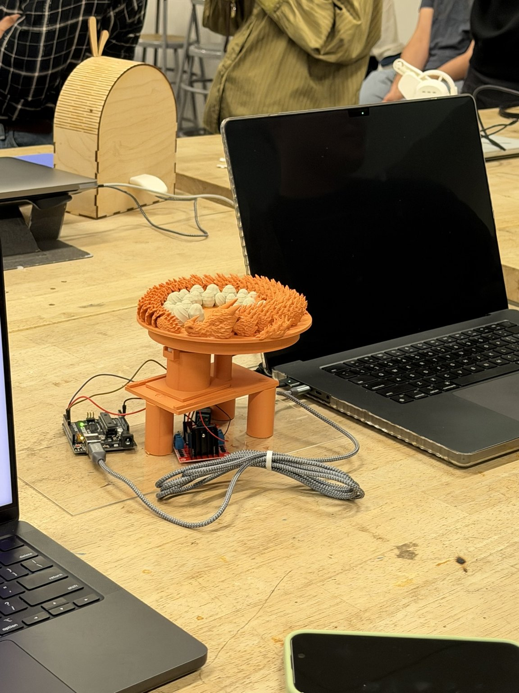

# W4 E2: Expressive Mechanics, the smile-controlled turntable dragon

**Week 4 · Project · Thu Nov 12, 2026 (critique)**
Lecture: [C07](../../sources/lecture-slides.md) (critique format, first rotation) · Full build repo: [turntable-dragon](https://github.com/cassiusp-beep/turntable-dragon)

## Assignment

Present Expressive Mechanics at the start of class and submit documentation on bCourses [C07, slides 6 and 7; B-EM].

## What I did

**The pivot.** At about 3 AM on Nov 12 I switched from cams to gears. I kept the printed dragon, the Uno and H-bridge, the motor and the control code, and replaced the mechanism with one gear pair under a lazy-Susan platter.

**How it works.** A webcam watches your face. Smile and the dragon spins, then keeps going for 10 s (about 3 turns) after you stop.

- **Smile detection** (`smile_dragon.py`, MediaPipe FaceMesh): mouth width (landmarks 61/291) divided by face width (234/454), compared with your relaxed face from a 2 s calibration. A smile above +10% held for 0.15 s starts the motor. Talking or opening your mouth doesn't widen it, so only a smile counts.
- **Firmware** (`dragon_motor.ino`): reads `S<0-100>` at 115200 baud, ramps speed changes, and stops the motor if the laptop goes quiet for 2 s.
- **Mechanism:** a 150 mm platter with an 80-tooth internal ring gear (module 1.5) on a centre post, driven by a 28T (2.86:1) or 17T (4.7:1) pinion. All parts fit on one Bambu plate (about 3 to 4 h). 0.6 mm total backlash; Rhino checked that the teeth never touch through a full turn.

**Bench testing.**
- USB power was too weak: the L298N's ~2 V drop left the motor about 3 V. A 6 V adapter on the motor terminal gives about 4 V.
- Reversing in code failed because IN2 wasn't reaching the L298N, so I swapped the motor leads on OUT1/OUT2 instead.
- With only about 4 V, I run the motor at full speed.

**Interaction pivot: scream to smile.** The first version (`scream_dragon.py`) blended mouth opening (65%) with microphone loudness (35%) into an "anguish" score that sped the dragon up. The smile switch suited the hardware better, since stopped vs. full speed is easy to see, and it doesn't need a quiet room. First-run bug: calibration ran before a face was in view, so it now keeps calibrating until it sees one.

## Media

| Final: geared turntable | Underneath: ring gear and pinion |
|---|---|
|  |  |

[Video: smile-controlled turntable dragon (MP4, 14 s)](media/smile-dragon-demo.mp4). The laptop webcam runs `smile_dragon.py`; when the smile crosses the threshold, the Uno drives the gearmotor through the L298N and the dragon spins on its platter.

**At the critique (Nov 12):** the finished turntable with the Flexi Dragon curled around the printed dragon eggs, wired to the Uno and L298N, with the laptop webcam watching for a smile.

| | | |
|---|---|---|
|  |  |  |

<!-- Required video: the dragon spinning when you smile (from the critique, if you have it). -->

## Code and circuit

- [`code/smile_dragon.py`](code/smile_dragon.py): final interaction
- [`code/scream_dragon.py`](code/scream_dragon.py): first interaction
- [`code/dragon_motor.ino`](code/dragon_motor.ino): Uno firmware
- Circuit and data flow: see the [diagrammatic analysis](../2026-11-12-w4-analysis/README.md).

## Results and reflection

At 3 AM before the demo I traded cams for gears: one pinion, one ring gear, one platter. Keeping the dragon, the Uno, the H-bridge and the code meant the pivot cost a night instead of the project. Fewer parts meant fewer places to bind, and Rhino could check the whole gear mesh through a full turn.

The interaction pivoted for a similar reason. Screaming to speed the dragon up depended on fine speed control, but with only about 4 V at the motor, calm and full speed looked almost the same. A smile switch, spin for ten seconds or stop, is something the hardware can show clearly. The interaction had to fit what the machine could express.

Bench testing taught me to suspect power and wiring before code: weak USB power, and an IN2 signal that never reached the L298N. Swapping the motor leads fixed direction without touching software. If I had another week, I'd bring back speed control with a stronger supply so the dragon could have more than one mood.

## Sources

- [R-DRAGON] Palacio, [turntable-dragon](https://github.com/cassiusp-beep/turntable-dragon) repository: CAD, firmware, interaction code and build notes
- [C07] class 07 deck, critique format and submission
- [B-EM] Expressive Mechanics brief
- [T-CV] Tewari, TDF_ComputerVision_HeadPositionControlsServo (starting point for camera to Arduino)
- Flexi Dragon by D3Craft (MakerWorld, Standard Digital File License)
- CAD and code developed with Claude Code
