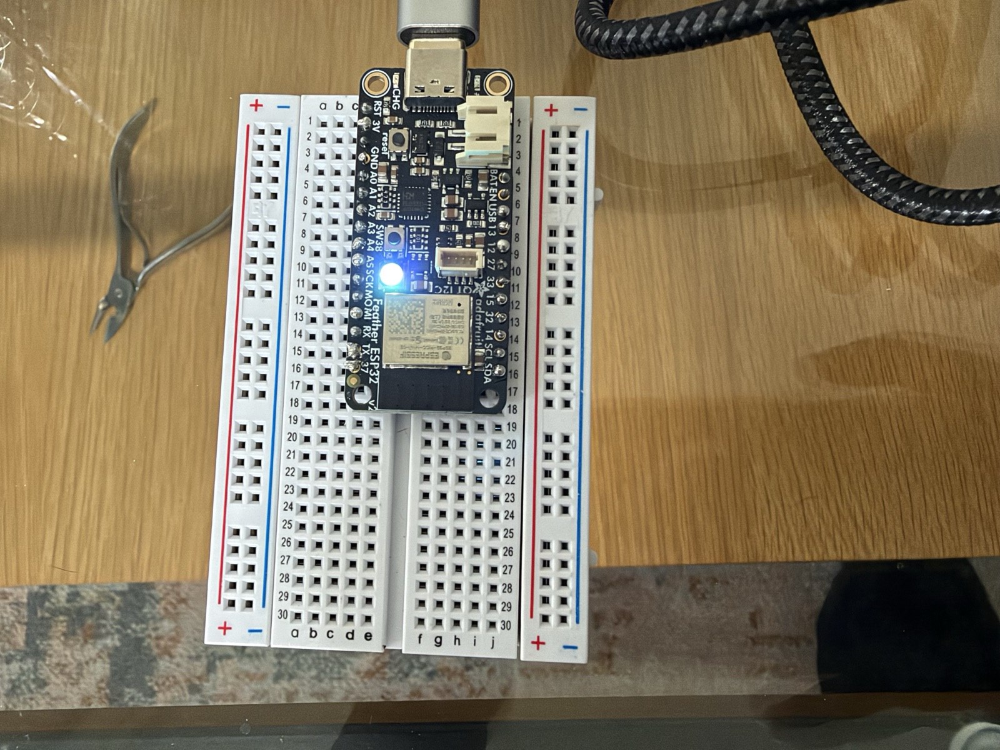
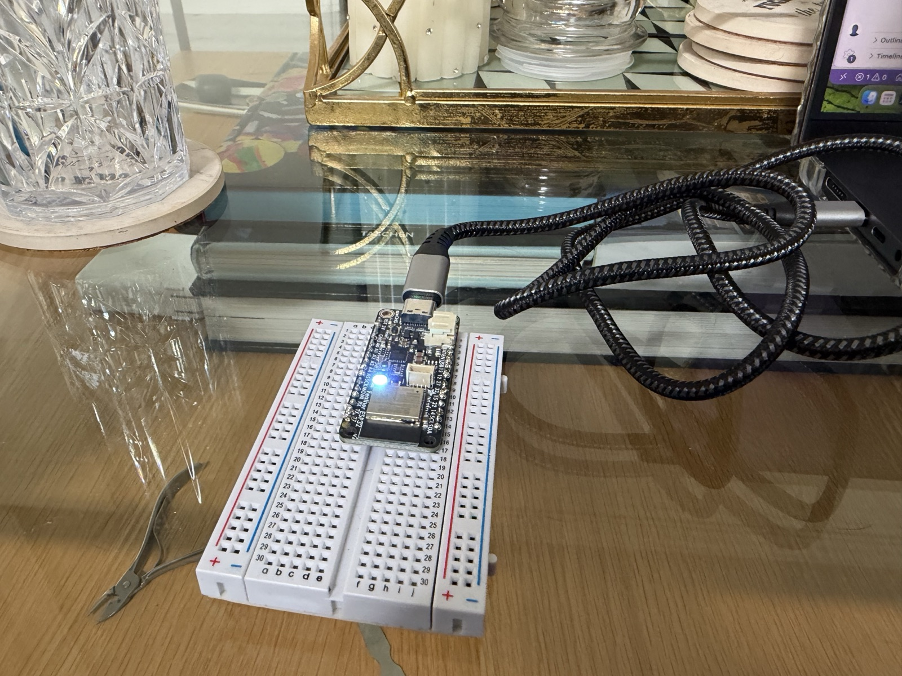
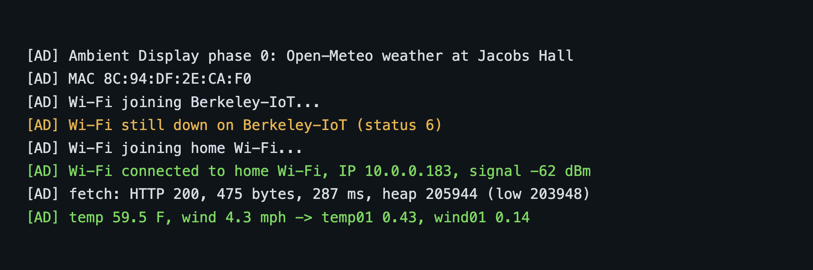

# W5 E1: ESP32 and web APIs

**Week 5 · Electronics · Tue Nov 17, 2026**
Lecture: [C23](../../sources/lecture-slides.md)

## Assignment

Project 2, Ambient Display, starts this week [C23, slides 20 to 35; B-AD].

Homework, due Tue Nov 24 [C23, slides 17 and 19]:
- Solder header pins on the ESP32 Feather V2, install its drivers and add it to the Arduino Board Support Package [T-FEATHER].
- Register the ESP32 with Berkeley IoT.
- Complete Roopa's ESP32 + weather API tutorial [T-ROOPA].
- Work on the Ambient Display: find interesting web APIs [T-APIS], use the onboard neopixel to display data, solder the neopixel strip, and document it in the journal.

In class: ESP32 vs Arduino (3.3V logic, not 5V tolerant; dual-core 32-bit), how an API GET request and JSON response work using Open-Meteo [T-METEO], and ambient and peripheral display theory [C23, slides 5 to 34].

## What I did

**Fri Nov 20 to Tue Nov 24: soldering, setup and a solder check.** I soldered the header pins onto the Feather ESP32 V2 at home on Fri Nov 20 (video below), and on Nov 24 I set up PlatformIO instead of the Arduino IDE [T-FEATHER]. The toolchain built and flashed a smoke test that cycles the onboard NeoPixel through red, green and blue, and I watched it cycle. I had expected to need the CH34x driver for the USB serial chip, but macOS already handles it, and the board showed up as `/dev/cu.usbserial-*`.

Before building on the board I wanted to know my solder joints were good. I wrote a small pin tester ([`code/pintest.cpp`](code/pintest.cpp)). It sets pins to `INPUT_PULLUP`, and I touch each one to GND with a jumper on the breadboard. The input-only pins (34, 36, 37, 39) have no pull-up, so I touched those to 3V instead, and pin 13 (the red LED) also to 3V. All 21 header signal pins passed, and nothing was bridged to GND or 3V at boot. I did not test USB, BAT, EN, RST or NC. I then registered the board with Berkeley IoT, and it joined Berkeley-IoT at about -77 dBm.

**Nov 24 to 27: from the tutorial to a small system.** I started from Roopa's weather tutorial [T-ROOPA] and the Open-Meteo request from class [T-METEO] [C23, slides 17 and 19], then split the code into three parts: `net` (Wi-Fi and HTTP), `data` (parsing the JSON into two numbers between 0 and 1) and `display` (the NeoPixel). I changed several things from the tutorial:

- **Non-blocking.** The HTTP request runs in a background FreeRTOS task and the LED animates on `millis()`, so there is no `delay()` and the light never freezes while it waits on the network.
- **A gradient, not three bands.** Temperature (40 to 85 F) maps to a smooth cool-to-warm color instead of three steps.
- **Wind is breathing speed.** The light breathes slowly when calm (6 s per breath) and faster in wind (1.5 s at 30 mph), instead of a `delay()` blink.
- **A calm stale cue.** If a fetch fails, the light greys, dims and breathes slowly, rather than going dark. It keeps the last good values.
- **Units.** Open-Meteo returns km/h unless you ask otherwise, and the tutorial labeled the number mph. I added `&windspeed_unit=mph`.

I had Claude Code run failure tests on the hardware: HTTP 400, captive-portal HTML instead of JSON, an empty body, an unresolvable host and a slow server. Every time it kept the last good values. That pass also found that the default partition table left only 1.25 MB for the app, which was 80.5% full. Switching to the 8 MB layout (`default_8MB.csv`) brought it to 31.6%. A review pass then asked for three changes before the showcase: a watchdog for a hung fetch, a single network at the venue, and a softer stale transition.

**Nov 27: working off campus.** Berkeley-IoT is out of range at home, so I added an optional second network. It never joined at first. A Wi-Fi diagnostic showed my home network is hidden (it was not in the scan) but still joinable, so I first suspected the hidden name. The real bug was that I switched networks without calling `WiFi.disconnect()` first, so the ESP32's auto-reconnect kept retrying the old network. The fix was one line, and it joined right away. At home it read 59.5 F and 4.3 mph, and I saw the light as a slowly breathing blue-teal (at 57 F earlier, by eye).

## Media







*Serial output from Nov 27, lightly redacted: my home network's name is replaced with "home Wi-Fi".*

```
[AD] Ambient Display phase 0: Open-Meteo weather at Jacobs Hall
[AD] MAC 8C:94:DF:2E:CA:F0
[AD] Wi-Fi joining Berkeley-IoT...
[AD] Wi-Fi still down on Berkeley-IoT (status 6)
[AD] Wi-Fi joining home Wi-Fi...
[AD] Wi-Fi connected to home Wi-Fi, IP 10.0.0.183, signal -62 dBm
[AD] fetch: HTTP 200, 475 bytes, 287 ms, heap 205944 (low 203948)
[AD] temp 59.5 F, wind 4.3 mph -> temp01 0.43, wind01 0.14
```

The earlier campus run on Nov 24 looked the same, on Berkeley-IoT: `Wi-Fi connected, IP 10.44.79.234, signal -77 dBm`, `fetch: HTTP 200, 477 bytes, 335 ms`, `temp 57.1 F, wind 1.4 mph -> temp01 0.38, wind01 0.05`.

[Video: soldering the Feather header pins, filmed Fri Nov 20 at home (11 s)](media/soldering-feather-headers.mp4). The board is held in helping hands (a Weller stand) under a magnifier, and I solder the header pins with a pen-style iron, with solder on a cutting mat.

TODO (Cassius, optional): a second video of the NeoPixel breathing with the room dimmed (10 to 30 s) would show the finished behavior better than the soldering clip.

## Code and circuit

**Circuit.** There is no external circuit yet. The Feather runs from USB-C and uses only its onboard NeoPixel on GPIO 0, which is powered through `NEOPIXEL_I2C_POWER` on GPIO 2, so there is no wiring to diagram. The board sits in a half breadboard only so the header pins are held steady. The solder test used jumper wires from single pins to GND or 3V. TODO (Cassius): the external NeoPixel strip is not soldered yet. When it is, add the wiring (power, ground, data pin, any level shifting) and a circuit diagram here.

Firmware, built with PlatformIO:

| File | What it does |
|---|---|
| [`code/main.cpp`](code/main.cpp) | Setup and loop: starts the network task, reads the latest values, drives the display |
| [`code/net.h`](code/net.h), [`code/net.cpp`](code/net.cpp) | Wi-Fi (primary and optional second network), background HTTP fetch, hung-fetch watchdog |
| [`code/data.h`](code/data.h), [`code/data.cpp`](code/data.cpp) | Parses the Open-Meteo JSON into `temp01` and `wind01` |
| [`code/display.h`](code/display.h), [`code/display.cpp`](code/display.cpp) | Color gradient, breathing speed and the stale cue on the NeoPixel |
| [`code/platformio.ini`](code/platformio.ini) | Board, libraries and the 8 MB partition layout |
| [`code/secrets.example.h`](code/secrets.example.h) | Template for the Wi-Fi names and passwords (the real `secrets.h` is not committed) |
| [`code/pintest.cpp`](code/pintest.cpp) | The solder joint tester |

## Other APIs explored

I looked at three keyless APIs from the public-apis list [T-APIS] and tried each request live on Nov 27, 2026. I have not chosen one yet, this is exploration.

| API | Request | What came back | Idea for the NeoPixel |
|---|---|---|---|
| NOAA CO-OPS tides, San Francisco (station 9414290) | `https://api.tidesandcurrents.noaa.gov/api/prod/datagetter?product=water_level&application=tdf_ambient&station=9414290&date=latest&datum=MLLW&time_zone=gmt&units=metric&format=json` | `data[0].v` in metres: 2.006 m at 18:36 GMT. It ranged from about -0.5 to 2.0 m that day, with a new value every 6 min. https only (http does not answer). | A level of light that rises and falls with the Bay. |
| USGS earthquakes (FDSN event API) | the `count` endpoint with a Northern California bounding box | 9 events of M2.5+ since Nov 26. The latest small quake was M0.71 near Cobb, CA. https only (http redirects with a 301). | Each new quake sends one slow pulse or ripple, and the 24 h count sets a glow level. Risk: it may look quiet on a calm day. |
| Open-Meteo air quality, Berkeley | `http://air-quality-api.open-meteo.com/v1/air-quality?latitude=37.87&longitude=-122.27&current=us_aqi,pm2_5` | US AQI 73, PM2.5 15.4, updated hourly. Works on plain http. | Clear air is bright and cool, smoky air is warm, dim and hazy. Risk: it is often flat all day, and it is close to the weather homework. |

Tides and quakes use https, so the firmware would need a secure client, and the 8 MB partition layout has room for that.

## Results and reflection

The Feather works. The LED cycles, all 21 header pins passed my test, it joins Wi-Fi on campus and at home, and it turns live weather into a color and a breathing speed. The part I would not have guessed is how much of the work was not the weather. The API call is a few lines. Making it reliable took most of the time: moving the network off the main loop, deciding what the light does when the data goes stale, and finding that a one-line `WiFi.disconnect()` was the real reason my home network would not join, after I had spent time blaming the hidden network name.

I used Claude Code for the build, the failure testing and the review, and I checked its results against the hardware and the serial log. The things I verified myself are the LED colors, the joined networks and the readings above.

The tutorial's three color bands and `delay()` blink would have worked, but they felt like a status light. A slow gradient and a breathing rhythm feel closer to the ambient and peripheral display ideas from class [C23, slides 5 to 34], where the display should be noticed without demanding attention.

Next steps toward the Ambient Display: shoot the video, pick and test the other APIs, solder the NeoPixel strip and extend the display to it, then test everything on the single network at the venue before the Jacobs Design Showcase on Tue Dec 8.

## Sources

- [C23] 2026 TDF - PhysComp class 23 - Project 2 intro - webAPI (slides 5 to 34, 17 and 19)
- [T-FEATHER] Adafruit, ESP32 Feather V2 getting started
- [T-ROOPA] R. Ramanujam, ESP32 web API example (weather)
- [T-METEO] Open-Meteo forecast API
- [T-APIS] public-apis list
- [B-AD] Project 2: Ambient Display brief
- AI assistance (Claude Code) is covered by the AI use statement in the [journal README](../../README.md).
