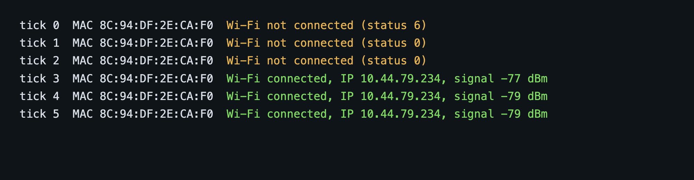

# W6 E1: Getting the ESP32 online

**Week 6 · Electronics · Tue Nov 24, 2026**
Lecture: [C25](../../sources/lecture-slides.md)

## Assignment

Class 25 was a short lecture and work session [C25]. It included an Othermill PCB milling demo, with links to the Jacobs Makerspace Othermill CNC training, the Bantam Tools desktop milling machine video and KiCad PCB design resources. The timeline: no class Thu Nov 26 (holiday), work sessions Tue Dec 1 and Thu Dec 3, the working prototype demo on Thu Dec 3 [C24], critique and the Jacobs Design Showcase on Tue Dec 8 (Jacobs 310, 12:00 to 3:30 pm, arrive at 11:00 to set up), and documentation due Tue Dec 15 [C24; C25].

The ESP32 homework from the week before was still open [C23, slides 17 and 19]: get the board working, register it with Berkeley IoT, and start on the web API tutorial.

## What I did

After the short lecture I spent the session setting up the ESP32 so it could talk to the internet. The finished weather display and the homework write-up are in [W5 E1](../2026-11-17-w5-electronics/README.md). This entry covers getting the board online.

1. **Toolchain and a smoke test.** I used PlatformIO to build and flash a small test that cycles the onboard NeoPixel red, green and blue and prints a tick over serial. macOS's built-in driver handled the USB serial chip, so I did not need the CH34x driver. The LED cycled through the three colors, which told me the toolchain, the cable and the board all worked.
2. **Solder joints.** I checked the header pins with a small pin tester. All 21 header signal pins passed, with no bridges to GND or 3V. The details are in W5 E1.
3. **MAC address.** I extended the smoke test to print the Wi-Fi MAC address, since Berkeley IoT needs it to register a device.
4. **Joining Wi-Fi.** I registered the MAC with Berkeley IoT, then extended the test again to join the network named in `secrets.h` and print the connection status each second. The board joined Berkeley-IoT in about 3 seconds. The first tick says "not connected (status 6)", then it connects at tick 3 with a signal of about -77 dBm.
5. **Next.** I started porting Roopa's Open-Meteo tutorial [T-ROOPA], which I finished on Nov 27 (see W5 E1).

## Media



The real serial output from Nov 24:

```
tick 0  MAC 8C:94:DF:2E:CA:F0  Wi-Fi not connected (status 6)
tick 1  MAC 8C:94:DF:2E:CA:F0  Wi-Fi not connected (status 0)
tick 2  MAC 8C:94:DF:2E:CA:F0  Wi-Fi not connected (status 0)
tick 3  MAC 8C:94:DF:2E:CA:F0  Wi-Fi connected, IP 10.44.79.234, signal -77 dBm
tick 4  MAC 8C:94:DF:2E:CA:F0  Wi-Fi connected, IP 10.44.79.234, signal -79 dBm
tick 5  MAC 8C:94:DF:2E:CA:F0  Wi-Fi connected, IP 10.44.79.234, signal -79 dBm
```

TODO (Cassius): I have no video from Nov 24. If you have a short clip of the board joining Wi-Fi, or of the Othermill demo, compress it to H.264 under 20 MB, save it in `media/` and add a "Video:" link here. Otherwise a short re-shoot of the LED cycling would do.

## Code and circuit

**Circuit.** There is no external circuit. The Feather runs from USB-C and uses only its onboard NeoPixel, powered through `NEOPIXEL_I2C_POWER`, as in W5 E1. The board sat in a half breadboard to hold the headers steady.

The exact code that ran on Nov 24 is [`code/wifi_smoke_test.cpp`](code/wifi_smoke_test.cpp). It cycles the NeoPixel, starts Wi-Fi in station mode (the station MAC is the one Berkeley IoT registers), calls `WiFi.begin()` with the network from `secrets.h`, and prints the MAC and connection state once a second. `WiFi.begin()` connects in the background, so the loop keeps running while it joins.

## Results and reflection

The session was small but it unblocked everything after it. Before I could ask a web API for anything, I needed proof at each layer: the toolchain builds, the board flashes, the solder joints hold, the network knows the device, and the board gets an IP address. Doing it as one test that grows by a line at a time made it easy to see which layer failed. Here, none did. The first "status 6" tick looks like a failure but is just the board still joining, and by tick 3 it was online.

The signal of about -77 dBm is weak. It worked on campus, but I should keep an eye on it when I choose where the finished display sits at the showcase.

The lecture also fixed my calendar: a working prototype by Thu Dec 3 [C24], and the showcase on Tue Dec 8 [C25]. I used Claude Code for part of this setup and checked the results on the hardware.

Next: a weather-driven NeoPixel (W5 E1), and a mechanical idea chosen on Nov 27, a diagonal wave whose speed is the data, which later entries will document.

## Sources

- [C25] 2026 TDF - PhysComp class 25 - Work Session
- [C24] 2026 TDF - PhysComp class 24 - Work Session (project timeline)
- [C23] 2026 TDF - PhysComp class 23 (slides 17 and 19, ESP32 homework)
- [T-ROOPA] R. Ramanujam, ESP32 web API example (weather)
